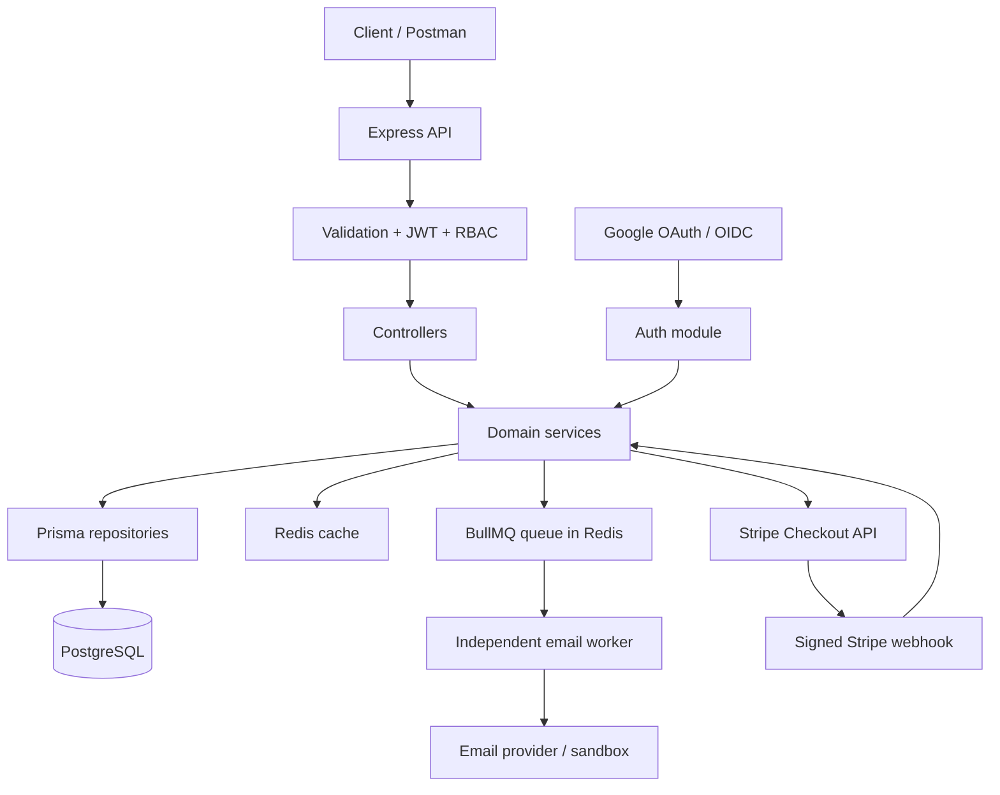

# Project 1 - Repository-Aware Backend Implementation Roadmap

Based on the uploaded snapshot `01-backend-api.zip` (reviewed October 24, 2026).

> Scope: A portfolio-ready **E-commerce Backend API** built by extending the existing Product scaffold. This is a development plan, not a claim that its tasks have been implemented or tested. The code was inspected statically; it was not executed against PostgreSQL, Redis, Stripe, Google, or AWS.

## 0. Goal and boundaries

Build one credible end-to-end scenario:

1. A customer registers or signs in (password or Google).
2. An admin creates products and manages stock.
3. A customer lists products and creates an order.
4. Stock is reserved without overselling.
5. The customer pays in Stripe test mode.
6. The Stripe webhook safely confirms payment and finalizes the order.
7. An asynchronous worker sends a confirmation email.
8. The API is documented, tested, containerized, and deployed or deployment-ready on AWS.

**Use the existing stack:** Node.js, Express 5, TypeScript, Prisma 7, PostgreSQL, Redis, Pino, Zod, JWT, OpenAPI, Docker Compose. Add BullMQ, Stripe, Google OAuth, and CI only when their prerequisites work.

**Out of MVP scope:** frontend shopping site, multi-vendor marketplace, coupon engine, taxes/shipping calculations, real financial refunds, subscriptions, Kubernetes, event sourcing, microservices, and multi-region HA. These are optional follow-ups, not blockers.

**Rule for all five days:** A "day" is a milestone. Finish its acceptance criteria before advancing; do not rush through unsafe partial payment/auth flows just to meet a calendar target.

## 1. Existing repository: what can be reused

| Status | Component | Evidence / location | Next action |
|---|---|---|---|
| Present | Express app, TypeScript and modular structure | `src/app.ts`, `src/server.ts`, `src/modules/` | Fix build then extend |
| Present | Prisma PostgreSQL models and migrations | `prisma/schema.prisma`, `prisma/migrations/` | Add commerce models |
| Partial | Register/login/access JWT/refresh/logout | `src/modules/auth/` | Repair token lifecycle and security |
| Present, narrow | Global USER/ADMIN RBAC and protected admin health route | `src/middlewares/auth.ts`, `src/modules/admin/` | Apply to product/order endpoints |
| Present | Redis client and connectivity test | `src/config/redis.ts` | Add real cache use |
| Stub | Event queue | `src/common/queue/localQueue.service.ts` | Replace in-memory logging with a worker-backed queue |
| Present | Pino, request ID and custom errors | `src/common/logger.ts`, `src/middlewares/`, `src/errors/` | Harden correlation and redaction |
| Present | Liveness/readiness endpoints | `src/modules/health/` | Adjust readiness policy and error exposure |
| Present | Swagger/OpenAPI | `src/docs/swagger.ts` | Update as routes are added |
| Partial/broken | Product and user feature modules | `src/modules/products/`, `src/modules/user/` | Finish or remove unfinished stubs |
| Present | Five Node built-in-test files and custom HTTP test helper | `src/tests/` | Expand to real HTTP + DB integration testing |
| Partial | Docker Compose for PostgreSQL and Redis | `docker-compose.yml` | Add API and worker containers |
| Missing | Stripe, Google OAuth, real email processing, GitHub Actions, AWS deployment | No implementation in the inspected `src` tree | Add in Days 2-5 |

### Critical blockers - do these first

- [ ] **SEC-01** Remove `logger.info(loginCredentials)` in `src/modules/auth/auth.controller.ts`: it logs access and refresh tokens.
- [ ] **SEC-02** Remove `logger.info(data, "Tokendata")` in `src/modules/auth/auth.repository.ts`: the row currently contains the raw refresh token.
- [ ] **SEC-03** Actually hash opaque refresh tokens before writing them to `RefreshToken.tokenHash`; add a unique constraint/index on this column. Lookup using the hash.
- [ ] **SEC-04** Choose one consistent refresh-token type and transport. Currently login creates an opaque random string, while refresh creates a JWT. Prefer an opaque, cryptographically random token on both paths.
- [ ] **SEC-05** Make refresh-token consumption + replacement atomic. Concurrent refresh requests using the same old token must not both succeed.
- [ ] **SEC-06** Fix logout: `auth.routes.ts` has an unprotected logout route, and the controller reads `req.userId` even though middleware assigns `req.user`. Revoke the intended session or all sessions deliberately; test that old refresh tokens no longer work.
- [ ] **SEC-07** Validate account status and authorization when needed. JWT roles can become stale after a role change; check current DB permissions for sensitive admin operations.
- [ ] **SEC-08** Remove fallback admin credentials and printing of passwords in `scripts/seed-admin.ts` outside isolated local development.
- [ ] **SEC-09** `.env` and `.git` were included in the ZIP. Do not package them when sharing; if real credentials were shared, rotate them.
- [ ] **BUILD-01** Fix unfinished `src/modules/products/product.validate.ts` and incomplete `src/modules/user/` code so the TypeScript project parses and typechecks.
- [ ] **BUILD-02** Reconcile `tsconfig.json` (`noEmit: true`) with `npm run build` (`tsc --outDir dist`) and ESM imports. Choose a working compilation/bundling approach and prove `npm start` runs the newly built code.
- [ ] **BUILD-03** Make `.env.example` match `src/config/env.ts` exactly: currently the template uses `JWT_ACCESS_SECRET` but `env.ts` expects `JWT_SECRET`, among other name differences.
- [ ] **BUILD-04** Replace `const PORT = 3000` in `src/server.ts` with validated configuration.
- [ ] **BUILD-05** Mount new routes explicitly in `src/app.ts`. An existing folder or Prisma model does not make an API reachable.

## 2. Recommended overall architecture



Preserve your existing separation: `routes -> controller -> service -> repository`. Use `src/common/queue` as an adapter boundary, but do not call an in-memory log a durable queue.

### Proposed incremental layout

```text
src/
  app.ts
  server.ts
  config/
  common/
    logger.ts
    queue/
      queue.interface.ts
      bullmqQueue.service.ts             # new
  middlewares/
  modules/
    auth/                                # existing; harden
    admin/                               # existing
    products/                            # existing; complete
    orders/                              # new
    payments/                            # new
    oauth/                               # new, or auth/google.*
    notifications/                       # new
    health/                              # existing
  workers/
    email.worker.ts                      # new
  tests/
prisma/schema.prisma
docs/
.github/workflows/ci.yml                # new
Dockerfile                               # new
docker-compose.yml                       # extend
```

## 3. Working agreements and progress tracking

- Use task IDs `D1-01`, `D1-02` ... and mark tasks as `[x]` only after verification.
- After each milestone: `npm run typecheck`, `npm run build`, `npm test`, manual API smoke test, and a small Git commit.
- Write down: what was built, which test proved it, one production risk, and one tradeoff.
- Suggested branch sequence: `fix/build-and-config`, `fix/auth-token-security`, `feat/products-orders`, `feat/redis-bullmq`, `feat/stripe-google-auth`, `test/ci-docker`, `deploy/aws-mvp`.
- Do not add unrelated technologies for resume keywords. Prefer one complete vertical feature over five half-finished modules.

## 4. Day 1 - Baseline, secure authentication and RBAC

**Outcome:** A reliable build, validated configuration, safe login/refresh/logout, and demonstrated USER/ADMIN authorization.

### D1.01 Baseline and build

- [ ] Preserve your original ZIP; work from a clean working branch, not on the archived copy.
- [ ] Keep `.env` private; create a safe `.env.example` without real values.
- [ ] Run baseline commands and record results before modifications:

```bash
npm ci
npx prisma validate
npx prisma generate
npm run build
npm test
```

- [ ] Choose a consistent TypeScript build: e.g. `tsc --noEmit` for type checks plus a tested ESM bundler for distribution, **or** proper NodeNext compilation with `.js` import specifiers. Do not leave `noEmit: true` as the only build step.
- [ ] Repair `product.validate.ts`, incomplete `user` files, and any compiler errors.
- [ ] Add scripts: `typecheck`, `build`, `start`, `test`, `db:migrate` and `db:seed` as appropriate. Ensure `npm start` actually starts compiled output.
- [ ] Use validated `env.PORT` and fail fast on missing configuration.
- [ ] Add a final 404 middleware after routes, before the error handler.

**Proof:** The typecheck/build succeed, a fresh process starts, and `GET /health/live` returns 200.

### D1.02 Harden user registration and login

Files: `src/modules/auth/auth.types.ts`, `auth.service.ts`, `auth.repository.ts`, `auth.controller.ts`, `src/common/token.ts`.

- [ ] Normalize email consistently at input boundaries; enforce uniqueness in the DB.
- [ ] Keep Argon2 password hashing; do not hash passwords inside a long-running database transaction if that CPU work can safely be done beforehand.
- [ ] Enforce minimum password requirements and login rate limits.
- [ ] Check `User.status` on login and protected actions, not only password correctness.
- [ ] Verify access-token signature, algorithm, expiry and required claims; restrict admin authorization to currently permitted roles.
- [ ] Remove access/refresh tokens and password material from logs; add Pino redaction for sensitive fields.
- [ ] Handle concurrent duplicate registration via DB unique constraint, not only pre-check queries.

**Proof:** Valid login succeeds; invalid credentials and disabled accounts cannot log in; no raw token appears in logs.

### D1.03 Repair refresh and logout end-to-end

- [ ] Standardize on one opaque refresh-token representation created from secure random bytes.
- [ ] Store only a cryptographic digest (such as SHA-256 of a sufficiently random token), never the raw bearer token.
- [ ] Mark `RefreshToken.tokenHash` unique; migrate existing development tokens safely (invalidate old dev sessions if needed).
- [ ] Rotate tokens in one transaction or compare-and-swap operation. Only one request can consume a given old token.
- [ ] Decide transport: for a browser client, prefer `HttpOnly`, `Secure` in production, appropriate `SameSite` cookie and CSRF-aware design; do not simultaneously expose the same refresh token in JSON unless explicitly required.
- [ ] Align refresh input validation, cookie parser, controller, API documentation and tests with that transport.
- [ ] Implement logout to revoke the active refresh session (and optionally a separate logout-all operation). Clear the cookie consistently.
- [ ] Test old-token reuse, expired tokens, logout revocation and two simultaneous refresh attempts.

**Proof:** After refresh, the old token fails. After logout, its session cannot refresh. Tokens are never stored or logged in plaintext.

### D1.04 RBAC and user profile

- [ ] Finish `GET /api/v1/users/me` or `GET /api/v1/auth/me` (choose one canonical route).
- [ ] Load the currently authenticated user and return a safe projection (no password hash, refresh tokens).
- [ ] Preserve the existing `USER` / `ADMIN` roles for this commerce project; do not introduce workspace roles without a workspace feature.
- [ ] Test guest -> 401; USER on admin route -> 403; ADMIN -> 200; disabled user -> denied.
- [ ] Harden `requestIdMiddleware` to avoid blindly accepting arbitrary/unbounded caller headers.

### Day 1 acceptance criteria

- [ ] New build and tests run on a clean checkout.
- [ ] Register -> login -> protected profile works.
- [ ] Refresh rotation and logout revocation are demonstrably correct.
- [ ] USER cannot access admin endpoint; ADMIN can.
- [ ] `JWT_SECRET` configuration and `.env.example` are consistent.

## 5. Day 2 - Product CRUD, order schema, pagination, Redis and email queue

**Outcome:** Admins manage products, users place pending orders without overselling, reads can be cached, and an email job runs independently.

### D2.01 Complete existing products module

Files already present: `src/modules/products/product.types.ts`, `product.validate.ts`, `product.controller.ts`, `product.service.ts`, `product.repository.ts`, `product.routes.ts`, `product.mapper.ts`.

- [ ] Keep the existing `Product` Prisma model; define the product API payload separately from DB-generated fields.
- [ ] Complete Zod validation and pass validated payloads to controllers.
- [ ] Implement repository operations (create, find, list, update, change active/inactive status).
- [ ] Implement service business rules (e.g. inactive products cannot be newly ordered).
- [ ] Implement thin controllers and mount product router at `/api/v1/products`.
- [ ] Restrict create/update/deactivate to ADMIN; allow safe public product listing and detail.
- [ ] Represent price with Prisma Decimal or integer minor units; avoid floating-point money calculations.
- [ ] Enforce consistent currency rules (simplify MVP to one currency).
- [ ] Add filtering by `status`, `search`, sorting, `limit`, and either offset or cursor pagination with stable tie-breaker.
- [ ] Update Swagger and test 400/401/403/404/422 and successful CRUD.

**Target API:**

| Method | Path | Access | Behavior |
|---|---|---|---|
| GET | `/api/v1/products` | Public | Paginated list |
| GET | `/api/v1/products/:id` | Public | Product details |
| POST | `/api/v1/products` | ADMIN | Create product |
| PATCH | `/api/v1/products/:id` | ADMIN | Update product |
| PATCH | `/api/v1/products/:id/status` | ADMIN | Activate/deactivate |

### D2.02 Create inventory and order data model

Proposed Prisma models (adjust names/fields to your existing conventions):

| Model | Fields and constraints that matter |
|---|---|
| `Inventory` | `productId UNIQUE FK`, `availableQuantity`, `reservedQuantity`, `updatedAt` |
| `Order` | `id`, `userId FK`, `status`, `totalAmount`, `currency`, `createdAt`, `expiresAt` |
| `OrderItem` | `id`, `orderId FK`, `productId FK`, `quantity`, `unitPrice`, `lineTotal` |

- [ ] Choose explicit order states: `PENDING_PAYMENT`, `PAID`, `CANCELLED`, `EXPIRED`.
- [ ] Add positive-quantity validation and database-enforced nonnegative inventory constraints where feasible.
- [ ] Preserve the product price snapshot in `OrderItem.unitPrice`.
- [ ] Add indexes for order ownership and ordered history: e.g. `(userId, createdAt, id)`.
- [ ] Define one atomic stock-reservation transaction: check/conditionally decrement available units; increment reserved units; create order and order items; commit together.
- [ ] Do not trust a total or price sent by the client. Calculate from DB prices.
- [ ] On cancellation/expiry release reserved stock **exactly once**, guarded by order status transition.
- [ ] Create migration and seed at least five products and stock records.

### D2.03 Build order endpoints

| Method | Path | Access | Behavior |
|---|---|---|---|
| POST | `/api/v1/orders` | Authenticated USER/ADMIN | Reserve stock and create pending order |
| GET | `/api/v1/orders` | Authenticated | List only caller's orders, paginated |
| GET | `/api/v1/orders/:id` | Owner or ADMIN | Detail plus items/status |
| POST | `/api/v1/orders/:id/cancel` | Owner or ADMIN | Release stock if allowed |

- [ ] Reject invalid quantities and unavailable products.
- [ ] Reject attempts to view another customer's order.
- [ ] Exercise concurrent requests for the final unit of stock; at most one order reserves it.
- [ ] Keep DB transactions short and do not call Stripe or an email provider inside them.

### D2.04 Add Redis cache-aside

- [ ] Create `src/common/cache/cache.service.ts` (or `src/config/cache.ts`) with `get/set/del`.
- [ ] Cache public product details and optionally filtered product lists, with a bounded TTL (start with ~60 seconds for testing).
- [ ] Use namespaced keys, e.g. `product:v1:{id}`.
- [ ] On admin product mutation, invalidate affected keys (or use list-versioned keys for listing caches).
- [ ] Cache only public-safe product fields; do not cache bearer tokens, raw refresh tokens, or private order data.
- [ ] If Redis is unavailable, decide and test whether the API reads from PostgreSQL instead.
- [ ] Demonstrate miss -> DB read -> hit -> invalidation -> refreshed value.

### D2.05 Replace the fake queue with real async processing

Existing `LocalQueueService` stores events in a process-local array and logs them. It is **not durable job processing**.

- [ ] Install and configure BullMQ to use Redis; keep `QueueService` interface or adapt it to typed job names/payloads.
- [ ] Create `BullMqQueueService`, queue configuration and a separate `email.worker.ts`.
- [ ] Produce `USER_REGISTERED` and `ORDER_CREATED` email jobs, using only necessary payload fields.
- [ ] Initially use a safe email sandbox or mocked email provider. Integrate SES or a transactional email provider later.
- [ ] Add retry with bounded attempts and exponential backoff; classify transient vs permanent failures.
- [ ] Use a deduplication key/job ID where appropriate; make worker effects as idempotent as practical.
- [ ] Add failure logging/metrics and graceful worker shutdown.
- [ ] Document the crash gap between DB commit and job enqueue; consider a transactional outbox as an important follow-up.

### Day 2 acceptance criteria

- [ ] ADMIN creates/updates product; USER receives 403 for admin operations.
- [ ] Public product list and detail work with validated pagination.
- [ ] A pending order contains correct prices and reserved stock.
- [ ] Two concurrent orders for the final stock item cannot both succeed.
- [ ] A Redis cache hit and invalidation can be demonstrated.
- [ ] A BullMQ worker processes at least one test email job.

## 6. Day 3 - Stripe payments, webhook idempotency and Google OAuth

**Outcome:** A customer can pay for a pending order using Stripe test mode. A signed webhook updates the database once. Google identities can log in or link safely.

### D3.01 Schema changes

| Model | Important data |
|---|---|
| `Payment` | `orderId`, `provider`, `stripeSessionId UNIQUE?`, `stripePaymentIntentId UNIQUE?`, `status`, `amount`, `currency`, timestamps |
| `PaymentEvent` | `provider`, `providerEventId UNIQUE`, `eventType`, `processedAt`, `processingStatus` |
| `OAuthAccount` | `userId FK`, `provider`, `providerUserId`, `createdAt`, `UNIQUE(provider, providerUserId)` |
| `IdempotencyKey` (optional for MVP) | `key`, `userId`, `requestHash`, `status`, `responseRef`, expiry |

Use nullable unique fields where the external provider identifier is not yet known. Capture provider IDs when assigned. Payment amount and currency must match the internal order, not untrusted frontend input.

### D3.02 Implement Stripe Checkout (one-time payments, not subscriptions)

- [ ] Set up Stripe test-mode prices/configuration and keep secret keys out of source control.
- [ ] `POST /api/v1/orders/:id/checkout`: verify caller owns an unexpired pending order, create payment intent/session as required, return Checkout URL.
- [ ] Use Stripe idempotency keys for retried API requests; avoid creating unlimited duplicate sessions for one pending order.
- [ ] Persist session/payment IDs and a pending payment record.
- [ ] `GET /api/v1/orders/:id/payment`: show server-side payment status.
- [ ] Never treat browser redirect to success page as proof of payment.

### D3.03 Webhook processing - high-priority correctness

- [ ] Mount `POST /api/v1/webhooks/stripe` using raw body parsing **before** global `express.json()` for that route.
- [ ] Verify Stripe's signature using the webhook signing secret; reject invalid signature.
- [ ] Route only supported event types; log or safely ignore unrelated types.
- [ ] Check actual payment completion/`payment_status`; handle asynchronous payment methods if enabled.
- [ ] Use unique `providerEventId` to deduplicate deliveries.
- [ ] In one DB transaction, apply a legal state transition to Payment/Order, finalize or release stock as needed, and mark the event processed. On failure, allow safe retry.
- [ ] Enqueue confirmation email **after** successful processing (document crash gap; outbox is optional hardening).
- [ ] Do not call external APIs while holding an inventory/payment DB lock.
- [ ] Test valid signature, invalid signature, duplicate event, out-of-order event, DB exception, delayed event, and cancelled/expired order.

**Proposed endpoints**:

| Method | Path | Meaning |
|---|---|---|
| POST | `/api/v1/orders/:id/checkout` | Create Stripe test Checkout session |
| GET | `/api/v1/orders/:id/payment` | Get persisted payment state |
| POST | `/api/v1/webhooks/stripe` | Signature-verified Stripe event receiver |

### D3.04 Google login and explicit account linking

- [ ] Implement OAuth 2.0 authorization-code / OIDC flow using `state`, nonce and PKCE where supported/appropriate.
- [ ] Configure exact redirect URLs; validate issuer, audience and provider identity claims.
- [ ] Find identities using the stable Google `sub`/provider user ID, not merely an email address.
- [ ] Create a new user or sign in to an already-linked account.
- [ ] Allow linking an existing account only after the caller authenticates to that account and completes an explicit linking flow.
- [ ] Handle existing-email collision safely: do not silently merge two accounts only because emails match.
- [ ] The existing `User.passwordHash` is nullable: use that for social-only accounts deliberately.
- [ ] Persist `(provider, providerUserId)` uniqueness and test replayed callbacks, invalid state, and duplicate linking attempts.

Suggested endpoints: `GET /api/v1/auth/google`, `GET /api/v1/auth/google/callback`, `POST /api/v1/auth/google/link` (choose and document exact callback/linking flow).

### Day 3 acceptance criteria

- [ ] Test Checkout creates a pending Stripe session for a valid customer order.
- [ ] A verified success webhook finalizes the order and stock **once**.
- [ ] Sending the same webhook twice has no duplicate business effect.
- [ ] Google login returns a functioning application session.
- [ ] Linking cannot hijack an existing account using an unverified matching email.

## 7. Day 4 - Testing, Docker, CI/CD, hardening

**Outcome:** New developers can run and test the service reproducibly, and high-risk business flows have automated verification.

### D4.01 Improve test infrastructure

Your existing suite uses `node:test` plus a custom `testHelper.ts`, even though Jest and Supertest appear in package dependencies. Preferred minimal-disruption approach: keep Node's test runner and use **Supertest** against Express. Move to Jest only if demonstrating Jest specifically matters; do not add migration risk to an already broad scope.

- [ ] Replace brittle custom request simulation with Supertest for route/integration tests.
- [ ] Add a dedicated test DB and isolated Redis namespace/database; never test against production.
- [ ] Clean up inserted records after tests or use repeatable fixtures.
- [ ] Unit test service rules with mocked repositories/provider adapters.
- [ ] Integration test real Prisma transactions for inventory and payment state transitions.
- [ ] Stub external Stripe/Google/email services in most tests; keep a small manual test-mode flow.
- [ ] Add race-condition test: simultaneous orders for last stock unit.

**Minimum meaningful test matrix**:

| Area | Tests |
|---|---|
| Auth | register, duplicate email, wrong password, disabled account, JWT expiry, refresh one-time-use, logout revocation |
| RBAC | missing token -> 401, USER on ADMIN route -> 403, ADMIN -> success, cross-user order -> blocked |
| Product CRUD | invalid price, unauthorized mutation, valid create/list/update, inactive product |
| Orders | insufficient inventory, concurrent last item, accurate price snapshot, cancel/expire releases stock once |
| Cache | hit, miss, invalidation, Redis outage |
| Queue | enqueue, retry, duplicate job, worker failure |
| Stripe | valid/invalid signature, event deduplication, DB failure rollback, out-of-order state |
| OAuth | invalid state, account already linked, email collision, linking authorization |

### D4.02 Dockerize the API and worker

- [ ] Add a Dockerfile and `.dockerignore` (`.env`, `.git`, `node_modules`, `dist`, test artifacts excluded as appropriate).
- [ ] Add `api` and `worker` services to `docker-compose.yml`, alongside existing `db` and `cache`.
- [ ] Use runtime config and correct service DNS names (`db`, `cache`) instead of `localhost` inside containers.
- [ ] Add DB/Redis health checks and appropriate readiness behavior.
- [ ] Run migrations as an explicit, controlled step, not opportunistically from multiple application instances.
- [ ] Test startup, graceful shutdown, and restart behavior.
- [ ] Don't use the hardcoded Compose development database password in production.

### D4.03 GitHub Actions CI

- [ ] Create `.github/workflows/ci.yml` on push and pull request.
- [ ] Install with `npm ci` and pin a supported Node major version.
- [ ] Run typecheck/lint, Prisma validate/generate, unit tests, integration tests, build.
- [ ] Start ephemeral PostgreSQL/Redis for integration tests, or use service containers.
- [ ] Ensure a failing test prevents merge/deployment.
- [ ] Keep credentials as CI secrets/short-lived roles rather than hardcoded repository values.

### D4.04 Production-style middleware and diagnostics

- [ ] Use `helmet` and `cors` thoughtfully (already installed but not applied in `src/app.ts`); explicitly configure allowed origins.
- [ ] Add auth and webhook rate limiting where appropriate.
- [ ] Change request logging to a `res.on("finish")` / `close` approach instead of monkeypatching `res.json()`.
- [ ] Redact authorization headers, cookies, raw tokens, passwords, and provider secrets.
- [ ] Validate `x-request-id` length/format or generate your own trusted correlation ID.
- [ ] Add an explicit 404 response and test malformed JSON handling.
- [ ] Return generic errors from public readiness endpoints; keep infrastructure details in logs/metrics.
- [ ] Decide whether Redis is essential for readiness; product reads should degrade gracefully if cache fails.
- [ ] Handle SIGTERM/SIGINT: stop accepting requests, drain workers, close Redis/Prisma connections.

### Day 4 acceptance criteria

- [ ] CI passes from a clean checkout.
- [ ] `docker compose up --build` starts API, worker, PostgreSQL and Redis after correct configuration.
- [ ] Security/inventory/webhook test matrix is green.
- [ ] Request logs contain IDs and latency but no secrets.
- [ ] Failure and shutdown behavior is documented.

## 8. Day 5 - AWS deployment, secrets and operational readiness

**Outcome:** A reachable HTTPS API or an honest, reproducible AWS deployment runbook with cost-aware architecture.

### D5.01 Choose exactly one deployment profile

**Budget demo:** small EC2 host with isolated services and tight Security Groups; can be a good learning deployment but is not equivalent to managed multi-AZ production infrastructure. Avoid exposing PostgreSQL/Redis ports publicly.

**Stronger AWS reference architecture:** ECR -> ECS/Fargate API and worker -> RDS PostgreSQL + managed Redis/ElastiCache -> CloudWatch + Secrets Manager; public HTTPS via ALB/ACM, with API/database network separation. This has meaningful ongoing cost (especially managed database/cache, ALB and NAT), so estimate cost before deploying.

- [ ] Write down your chosen profile and why it fits the budget and goal.
- [ ] Do not build both profiles just for breadth.

### D5.02 Cloud deployment checklist

- [ ] Build and publish an image (or produce equivalent deployable artifact).
- [ ] Create least-privilege IAM permissions; prefer IAM roles and short-lived credentials.
- [ ] Keep database in private connectivity and restrict security groups to the required source services/ports.
- [ ] Provide secure secrets configuration for DB, JWT, Stripe, Google, email provider.
- [ ] Run `prisma migrate deploy` as part of a controlled release.
- [ ] Configure HTTPS and correct callback/webhook URLs for your deployed host.
- [ ] Run API and worker as independently restartable processes/services.
- [ ] Configure process-level health/liveness and readiness with correct dependency semantics.
- [ ] Set log retention, health/error alerts, and backup policies.
- [ ] Run a full test-mode transaction through API -> order -> Stripe -> webhook -> DB -> email worker.

### D5.03 Observability and incident drills

- [ ] Use consistent request IDs in API logs; propagate job/event IDs into worker logs.
- [ ] Track HTTP error rate, p95 latency, DB connectivity, Redis connectivity, queue backlog, failed jobs, and webhook failures.
- [ ] Create at least 3 actionable alerts, not noisy alerts for every minor event.
- [ ] Simulate DB outage, Redis outage, email failure and duplicate webhook handling in a safe test environment.
- [ ] Document the recovery steps for each failure.
- [ ] Create a rollback procedure for application releases; treat DB rollback separately and carefully.

### Day 5 acceptance criteria

- [ ] Public HTTPS health endpoint responds or an end-to-end reproducible deployment runbook exists.
- [ ] Secrets are not committed or embedded in images.
- [ ] The DB and Redis are not directly exposed to the public internet.
- [ ] At least one traceable order/payment/email test succeeds in test mode.
- [ ] The README explains deployment and known limitations accurately.

## 9. Project review milestone - diagrams, interviews, resume

- [ ] Write `docs/architecture/overview.md` describing actual modules and dependencies, not planned features.
- [ ] Add a Mermaid component diagram, a Mermaid ERD, and a sequence diagram for checkout/webhook/idempotency.
- [ ] Maintain an up-to-date OpenAPI endpoint catalog with auth rules, request examples, validation errors, and response examples.
- [ ] Create `docs/architecture/decisions.md`: why Postgres, why Prisma, why Redis cache, why BullMQ, why JWT, why Stripe webhooks, why chose the AWS deployment profile.
- [ ] Create `docs/operations/failure-scenarios.md`: DB unavailable, Redis unavailable, email worker retry, duplicate/out-of-order webhook, failed payment, expired order, process restart.
- [ ] Create `docs/operations/runbook.md`: local setup, migrations, seed, startup, testing, deployment, checking logs, rollback and backups.
- [ ] Add a clear README demo walkthrough with cURL/Postman examples and screenshots/metrics only if actually verified.
- [ ] Prepare a 90-second, 3-minute and 10-minute verbal project explanation.
- [ ] Write 3 resume bullets containing only features and results actually implemented/measured.
- [ ] Re-solve one failure scenario cold and explain it in Feynman style.

### Interview prompts to rehearse

1. Walk through authentication from password submission to token rotation and logout.
2. Why is storing raw refresh tokens unsafe, and why must rotation be atomic?
3. How do RBAC and resource ownership checks differ?
4. Why can two customers not purchase the final stock unit simultaneously?
5. Why is Stripe's success redirect not payment confirmation?
6. What happens when a Stripe webhook is retried, duplicated, or arrives out of order?
7. Why use BullMQ when Redis already exists? What happens if Redis is unavailable?
8. What is the crash gap between a Postgres commit and a queue publish? How would an outbox close it?
9. How does cache invalidation work after a product price update?
10. How do you deploy and debug this service on AWS?

## 10. Priority if implementation time is limited

| Priority | Do first | Reason |
|---|---|---|
| P0 | Typecheck/build, auth token safety, logout, role checks | Broken build and compromised credentials invalidate the rest |
| P0 | Product CRUD, Order/OrderItem, atomic stock reservation | Core business value and database correctness |
| P0 | Stripe test Checkout, raw-body signature check, idempotent webhook | High-value, failure-sensitive integration |
| P1 | Google login and explicit linking | Identity integration; requires hardened auth foundation |
| P1 | Redis cache, real BullMQ worker | Performance and asynchronous background work |
| P1 | High-value tests, CI, docs | Reliability and interview evidence |
| P1 | One deployed demo or reproducible AWS runbook | End-to-end delivery skill |
| P2 | Transactional outbox, DLQ, advanced monitoring, load testing | Valuable production follow-ups after MVP |
| P2 | Subscriptions, shipping/taxes, multi-AZ, Kubernetes | Out-of-scope unless MVP is already done |

## 11. The first 12 tasks to execute - in order

- [ ] 1. Create a working branch from the current repository and back up the existing state.
- [ ] 2. Stop exporting `.env` and `.git` in ZIP archives; rotate real secrets if exposed.
- [ ] 3. Record the baseline errors from `npx prisma validate`, `npm run build`, and `npm test`.
- [ ] 4. Fix incomplete product/user source files so compilation can proceed.
- [ ] 5. Fix TypeScript emitted build versus ESM runtime; prove `npm start` serves `/health/live`.
- [ ] 6. Align `.env.example`, `env.ts`, `server.ts`, and `prisma.ts` configuration.
- [ ] 7. Remove all token/password logging and configure log redaction.
- [ ] 8. Implement hashed opaque refresh tokens and a unique DB constraint.
- [ ] 9. Make refresh rotation atomic; test concurrent/reused old token failures.
- [ ] 10. Fix logout and add a protected `/me` route with user status checks.
- [ ] 11. Add at least four real HTTP auth/RBAC tests.
- [ ] 12. Complete `products` create/list/details routes and mount them in `app.ts`.

**Only after these pass** should you start new order/payment complexity.

## 12. Definition of done for the entire project

- [ ] A clean checkout can install, build, test and start without undocumented manual fixes.
- [ ] Password login, refresh, logout, RBAC and Google login behave safely.
- [ ] Admin product CRUD and customer order creation work.
- [ ] Prices come from DB snapshots; concurrent purchase cannot oversell stock.
- [ ] Stripe test-mode payment status is confirmed by verified webhooks and processed idempotently.
- [ ] Redis caching and a real separate email worker are demonstrated.
- [ ] Security-critical and concurrency-critical tests pass automatically in CI.
- [ ] An AWS deployment or reproducible deployment runbook exists with proper secrets and network boundaries.
- [ ] Architecture, API list, ERD, failure modes and tradeoffs match **actual implementation**.
- [ ] You can explain the project in 3 minutes without notes and handle follow-up system-design questions.

## 13. Lightweight study/revision routine while building

At the end of each build milestone, answer out loud without looking:

1. **What did I implement?** Name the precise endpoint or flow.
2. **Why does this design exist?** Explain the problem it solves.
3. **Where can it fail?** Predict one concurrency/security/dependency failure.
4. **How would I test that failure?** Name one deterministic test.
5. **What would I improve with more time?** Name a tradeoff, not random new technology.

Keep a `learning-log.md` with brief entries: `feature | why | verification | bug/fix | next review`. Revisit previous bugs after 1, 3, 7 and 30 days instead of rereading all project notes.
