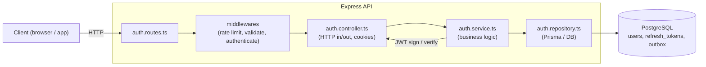
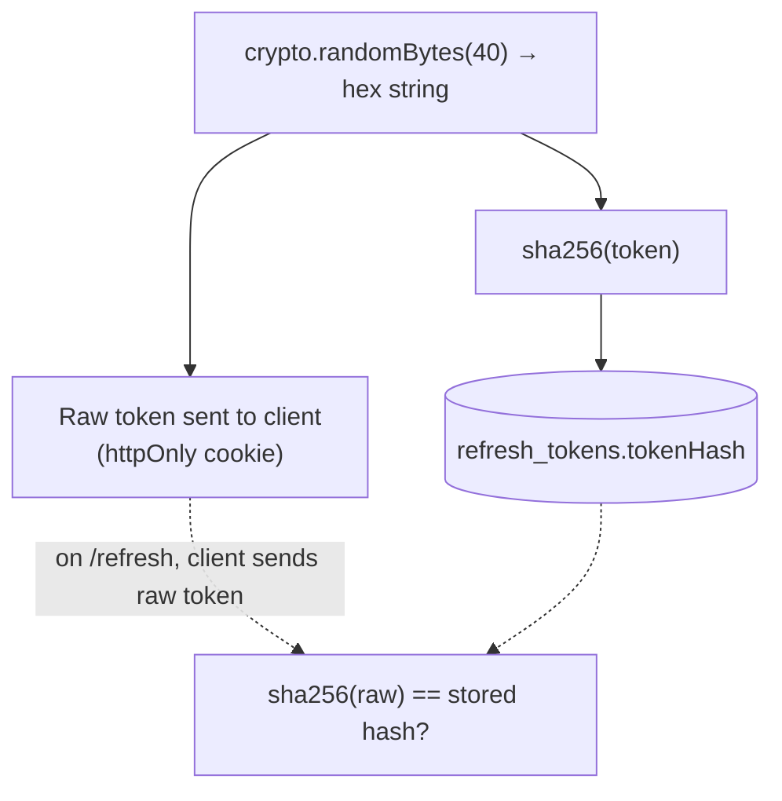
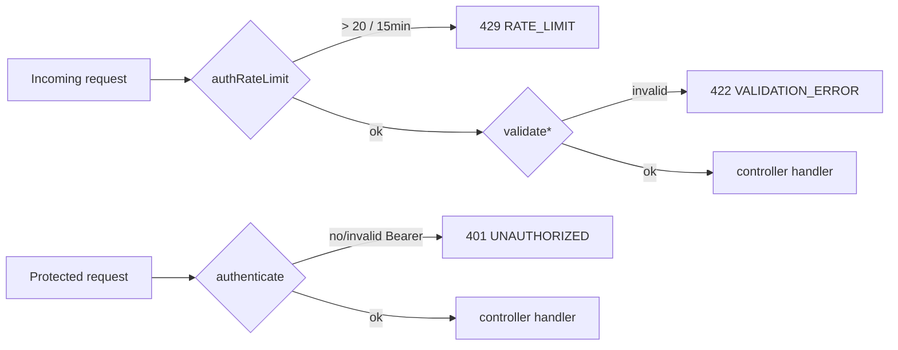
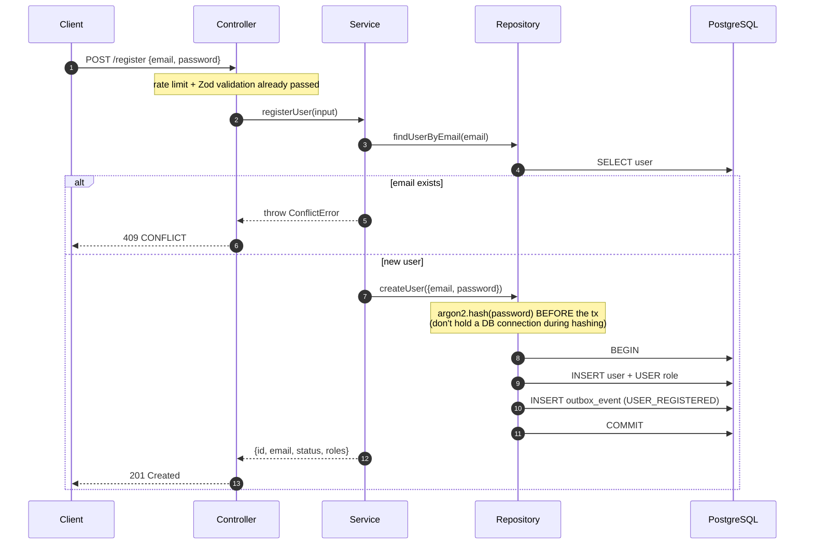
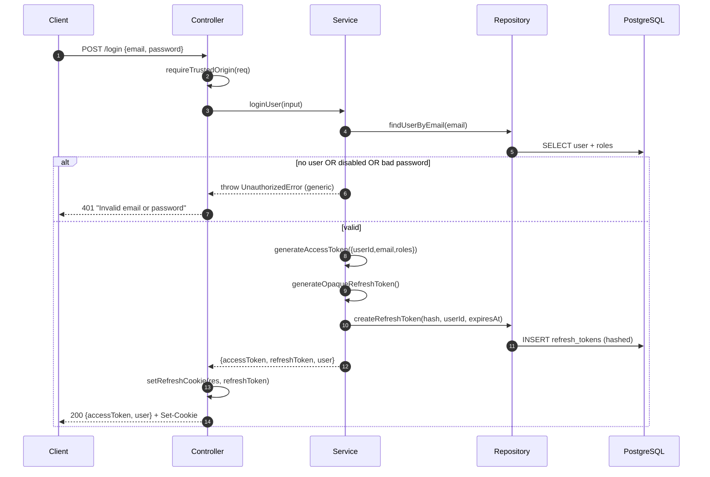
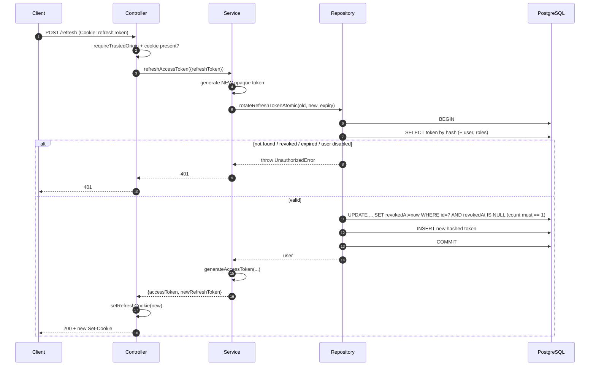
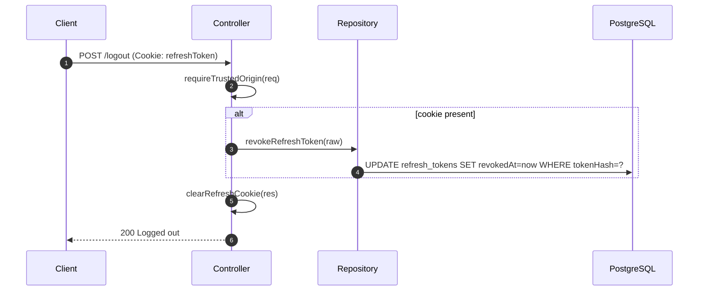
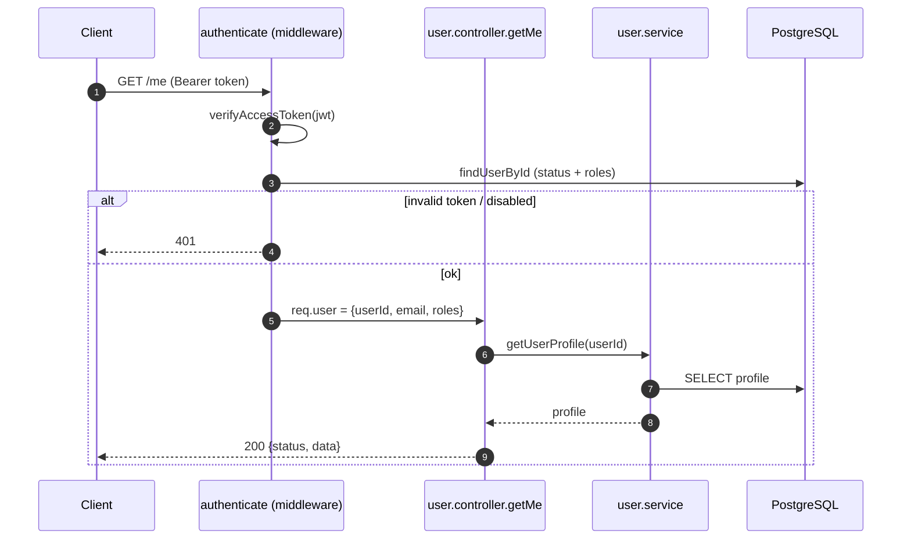
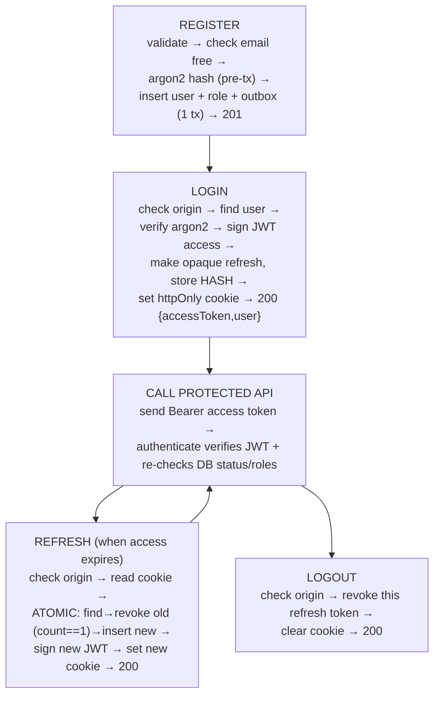

# Authentication API

Complete documentation for the authentication module.

This doc describes the code **as it actually is** today. It is written to be useful both as a day-to-day reference and as interview-prep material: it explains not just *what* each endpoint does, but *why* the design choices were made.

```
router.post("/register", authRateLimit, validateUserRegister, registerUser);
router.post("/login",    authRateLimit, validateUserLogin,    loginUser);
router.post("/refresh",  authRateLimit, refreshAccessToken);
router.post("/logout",                                        logoutUser);
router.get("/me",        authenticate,                        getMe);
```

---

## Table of contents

1. [Mental model (read this first)](#mental-model)
2. [The token strategy](#token-strategy)
3. [Middleware pipeline](#middleware-pipeline)
4. [Endpoints](#endpoints)
   - [POST /register](#post-register)
   - [POST /login](#post-login)
   - [POST /refresh](#post-refresh)
   - [POST /logout](#post-logout)
   - [GET /me](#get-me)
5. [Security design notes (interview gold)](#security-design-notes)
6. [Error model](#error-model)
7. [Quick revision flow](#quick-revision-flow)

---

## Mental model

The whole module is built around **two different kinds of tokens** doing two different jobs:

| Token | What it is | Lives where | Lifetime | Job |
|-------|-----------|-------------|----------|-----|
| **Access token** | A signed **JWT** (stateless) | Returned in JSON body, held by client in memory | Short (`15m`) | Proves "who you are" on every API call |
| **Refresh token** | An **opaque random string** (stateful) | `httpOnly` cookie + **hashed** row in DB | Long (`7d`) | Used only to get a fresh access token |

The key insight an interviewer wants to hear:

> Access tokens are **stateless and short-lived** so verification is fast and needs no DB hit. Refresh tokens are **stateful, long-lived, and stored server-side (hashed)** so they can be revoked and rotated. You get the performance of JWTs plus the control of sessions.

### How the pieces fit together



**Layering rule to remember:** the controller only touches HTTP concerns (request body, status codes, cookies). The service holds business logic and knows nothing about Express. The repository is the only layer that talks to the database. This separation is what makes the code testable and is a common interview talking point.

---

## Token strategy

### Access token (JWT)
Created in `common/token.ts` via `generateAccessToken`:

- Algorithm: **HS256** (shared secret, `env.JWT_SECRET`)
- Claims: `{ userId, email, roles }`
- Hardened with `issuer` (`backend-api`) and `audience` (`backend-api-client`) — both are **verified** on the way back in, which blocks tokens minted for a different service.
- Expiry: `env.JWT_EXPIRES_IN` (default `15m`)

### Refresh token (opaque)
Created via `generateOpaqueRefreshToken` → `crypto.randomBytes(40).toString("hex")`.

Two things to call out:

1. **It's opaque, not a JWT.** It carries no claims; it's just a random lookup key. Nothing can be decoded from it.
2. **Only its SHA-256 hash is stored** (`hashToken`). So even a full DB leak doesn't hand an attacker usable refresh tokens — the same reasoning as hashing passwords.



---

## Middleware pipeline

Three middlewares guard these routes. Order matters.



- **`authRateLimit`** — in-memory sliding window keyed by IP. Allows 20 attempts per 15 minutes, else `429`.
  > ⚠️ **Known limitation (say this in an interview):** it's **per-process and in-memory**, so it does not coordinate across multiple instances. For multi-instance production the real throttling must live at the gateway/WAF or in shared Redis. The code comments call this out on purpose — it's an intentional MVP tradeoff, not an oversight.
- **`validateUserRegister` / `validateUserLogin`** — Zod schema parsing. On success it **replaces `req.body` with the parsed/typed data**, so downstream code works with clean values.
- **`authenticate`** — extracts the `Bearer` token, verifies the JWT, then (if the DB is reachable) **re-checks the account in the DB**: rejects `DISABLED` accounts and refreshes the role list from the source of truth. This means a disabled or role-changed user can't keep acting on a still-valid JWT.

### Validation rules

| Field | Register | Login |
|-------|----------|-------|
| email | valid email | valid email |
| password | 10–100 chars | 6–100 chars |

> Note the asymmetry: register enforces a stronger minimum (10) to set a good password; login uses a looser minimum (6) and returns a **generic** error so it never reveals whether the email exists or the policy changed.

---

## Endpoints

### POST /register

Create a new local (email + password) account.

**Request**
```http
POST /api/auth/register
Content-Type: application/json

{
  "email": "jane@example.com",
  "password": "sup3rsecret!"
}
```

**Success — `201 Created`**
```json
{
  "message": "User registered successfully",
  "user": {
    "id": "c1a2...",
    "email": "jane@example.com",
    "status": "ACTIVE",
    "roles": ["USER"]
  }
}
```

**Errors**

| Status | Code | When |
|--------|------|------|
| 409 | `CONFLICT` | Email already registered |
| 422 | `VALIDATION_ERROR` | Bad email / weak password |
| 429 | `RATE_LIMIT` | Too many attempts from the IP |

**Flow**



**Two production details worth remembering:**

1. **Password hashing happens *before* the transaction opens.** Argon2 is deliberately slow (that's the point). Hashing inside a transaction would keep a scarce DB connection pinned for the whole hash duration. Pre-hashing keeps transactions short.
2. **Outbox pattern.** The `USER_REGISTERED` event is written to an `outbox_event` row **inside the same transaction** as the user insert. So the event and the user commit atomically — you can never end up with a user but no event (or vice versa). A separate publisher later reads the outbox and emits to the real queue. This is the standard answer to "how do you reliably publish events with a DB write?"

---

### POST /login

Exchange credentials for an access token (JSON) + refresh cookie.

**Request**
```http
POST /api/auth/login
Content-Type: application/json
Origin: https://your-frontend.app

{ "email": "jane@example.com", "password": "sup3rsecret!" }
```

**Success — `200 OK`**
```json
{
  "message": "Login successful",
  "data": {
    "accessToken": "eyJhbGciOiJIUzI1NiIsInR5cCI6...",
    "user": { "id": "c1a2...", "email": "jane@example.com", "roles": ["USER"] }
  }
}
```
Plus a `Set-Cookie: refreshToken=...; HttpOnly; SameSite=Lax; Path=/` (and `Secure` in production).

**Errors**

| Status | Code | When |
|--------|------|------|
| 401 | `UNAUTHORIZED` | Wrong email **or** password, or account `DISABLED` |
| 403 | `FORBIDDEN` | Request `Origin` present but not in allow-list |
| 422 | `VALIDATION_ERROR` | Malformed body |
| 429 | `RATE_LIMIT` | Too many attempts |

**Flow**



**Interview details:**

- **Uniform error message.** Unknown email, wrong password, and disabled account all return the exact same `401 "Invalid email or password"`. This prevents **user enumeration** (an attacker can't tell which emails are registered).
- **Social-only accounts.** If a user signed up via Google and has no `passwordHash`, the code **does not** call `argon2.verify` with an empty hash — it short-circuits to "invalid". Avoids a crash and avoids leaking account type.
- **The refresh token goes in an `httpOnly` cookie**, never in the JSON body. JavaScript can't read it, which defends against XSS token theft.

---

### POST /refresh

Rotate the refresh token and mint a new access token. The client doesn't send anything in the body — it just needs the `refreshToken` cookie.

**Request**
```http
POST /api/auth/refresh
Cookie: refreshToken=<opaque token>
Origin: https://your-frontend.app
```

**Success — `200 OK`**
```json
{ "message": "Token refreshed", "data": { "accessToken": "eyJ..." } }
```
Plus a **new** `Set-Cookie: refreshToken=...` (the old one is now dead).

**Errors**

| Status | Code | When |
|--------|------|------|
| 401 | `UNAUTHORIZED` | Missing cookie, or token invalid/expired/revoked/already used, or account disabled |
| 403 | `FORBIDDEN` | Untrusted `Origin` |
| 429 | `RATE_LIMIT` | Too many attempts |

**Flow — atomic rotation**



**This endpoint is the one interviewers dig into. Key points:**

- **Refresh token rotation.** Every refresh *consumes* the old token and issues a brand-new one. A refresh token is single-use.
- **The whole thing is one DB transaction** (`rotateRefreshTokenAtomic`). Look up → revoke old → insert new, all atomic.
- **Race / replay protection.** Revocation uses a conditional `updateMany(... WHERE revokedAt IS NULL ...)` and asserts the affected row count is exactly `1`. If two concurrent requests present the same token, only one update matches; the other sees `count !== 1` and is rejected. So a stolen-and-replayed token can't be used in parallel with the legitimate client.
- **Status re-check.** Even mid-session, a `DISABLED` account is rejected during rotation.

---

### POST /logout

Revoke the current refresh session and clear the cookie.

**Request**
```http
POST /api/auth/logout
Cookie: refreshToken=<opaque token>
Origin: https://your-frontend.app
```

**Success — `200 OK`**
```json
{ "message": "Logged out successfully" }
```

**Behavior notes:**

- It revokes **only the presented refresh token's session**, not every session the user has on other devices. (A "log out everywhere" would call `revokeAllUserTokens`, which exists in the repository but isn't wired to this route.)
- It's **idempotent and forgiving**: if there's no cookie, it still clears the cookie and returns 200. No rate limiter on logout — you never want to trap a user who's trying to leave.
- `requireTrustedOrigin` still applies.



---

### GET /me

Return the authenticated user's profile. This is the alias/profile endpoint and the simplest example of a protected route.

**Request**
```http
GET /api/auth/me
Authorization: Bearer <accessToken>
```

**Success — `200 OK`**
```json
{
  "status": "success",
  "data": {
    "id": "c1a2...",
    "email": "jane@example.com",
    "status": "ACTIVE",
    "roles": ["USER"],
    "createdAt": "2026-01-01T00:00:00.000Z",
    "updatedAt": "2026-01-01T00:00:00.000Z"
  }
}
```

**Errors**

| Status | Code | When |
|--------|------|------|
| 401 | `UNAUTHORIZED` | Missing/invalid/expired Bearer token, or account disabled |
| 404 | `NOT_FOUND` | User id not found in DB |



> Note: `authenticate` does the JWT verification **and** a fresh DB status/role check, so the handler can trust `req.user` completely.

---

## Security design notes

A single list you can skim before an interview. Each is implemented in the code above.

1. **Split tokens** — stateless short JWT for auth, stateful long opaque token for refresh. Best of both worlds.
2. **Refresh tokens hashed at rest** (SHA-256). DB leak ≠ usable tokens.
3. **Refresh token rotation + single-use** with an atomic, count-checked revoke → replay/race safe.
4. **`httpOnly` + `SameSite=Lax` + `Secure`-in-prod cookies** → refresh token is unreadable by JS (XSS) and not auto-sent cross-site (CSRF).
5. **Origin allow-list (`requireTrustedOrigin`)** on all cookie-driven, state-changing routes (login/refresh/logout) → extra CSRF defense for browser clients, while still allowing non-browser clients that omit `Origin`.
6. **Generic auth errors** → no user enumeration.
7. **Argon2** password hashing, computed outside the DB transaction.
8. **Live account re-check** in `authenticate` and on refresh → disabled/role-changed users lose access immediately, not after token expiry.
9. **JWT `issuer`/`audience` verified**, HS256 algorithm pinned → blocks cross-service and `alg`-confusion style misuse.
10. **Transactional outbox** → events published reliably with the DB write.
11. **Rate limiting** on auth routes — with the documented caveat that the in-memory limiter is MVP-only and must be fronted by a gateway/Redis in multi-instance prod.

---

## Error model

All errors flow through `AppError` subclasses and come out in a consistent shape:

| Error class | Status | `code` |
|-------------|--------|--------|
| `BadRequestError` | 400 | `BAD_REQUEST` |
| `UnauthorizedError` | 401 | `UNAUTHORIZED` |
| `ForbiddenError` | 403 | `FORBIDDEN` |
| `NotFoundError` | 404 | `NOT_FOUND` |
| `ConflictError` | 409 | `CONFLICT` |
| `ValidationError` | 422 | `VALIDATION_ERROR` (includes per-field `details`) |
| `authRateLimit` (inline) | 429 | `RATE_LIMIT` |

---

## Quick revision flow

The 60-second recap to read before an interview or when you come back to this code.



**One-liner per endpoint:**

- **`POST /register`** → create account (hash before tx, emit event via outbox). `201`.
- **`POST /login`** → credentials in, short JWT in body + long opaque refresh in httpOnly cookie. `200`.
- **`GET /me`** → send Bearer JWT, get your profile; middleware re-validates you against the DB. `200`.
- **`POST /refresh`** → spend the refresh cookie, atomically rotate it, get a new access token. `200`.
- **`POST /logout`** → revoke this session's refresh token, clear the cookie. `200`.

**The three sentences that cover 80% of the follow-up questions:**

1. *Why two tokens?* Stateless JWT for fast auth checks; stateful hashed refresh token so sessions can be revoked and rotated.
2. *Why is refresh rotation safe under races?* The revoke is a conditional update that must affect exactly one row, so a replayed token can't be consumed twice.
3. *Why httpOnly cookie + Origin check?* The refresh token is invisible to JS (XSS-safe) and the Origin allow-list blocks cross-site state changes (CSRF-safe).
