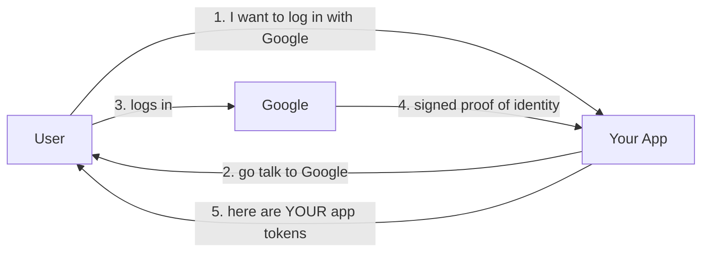
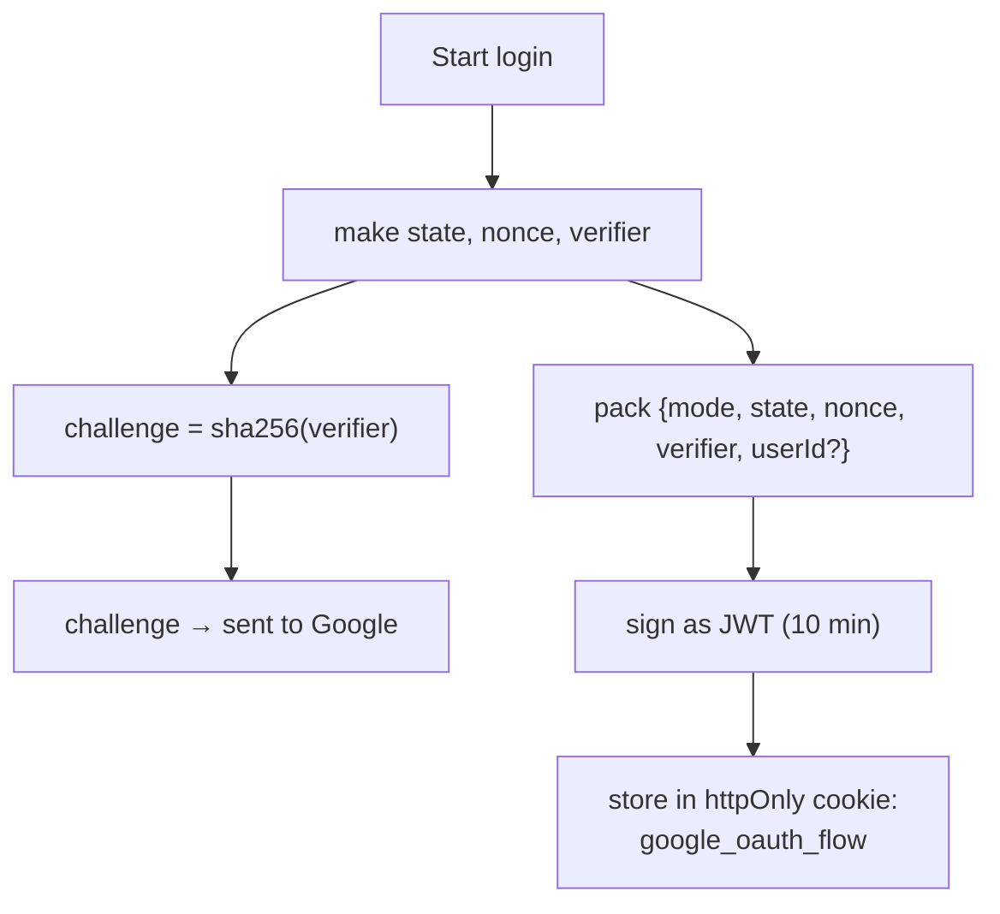
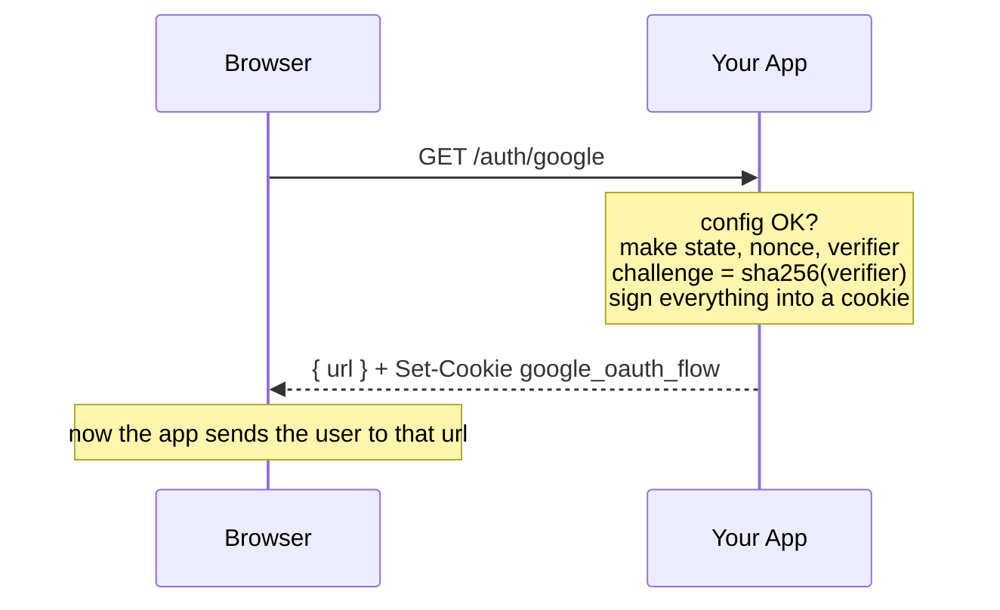
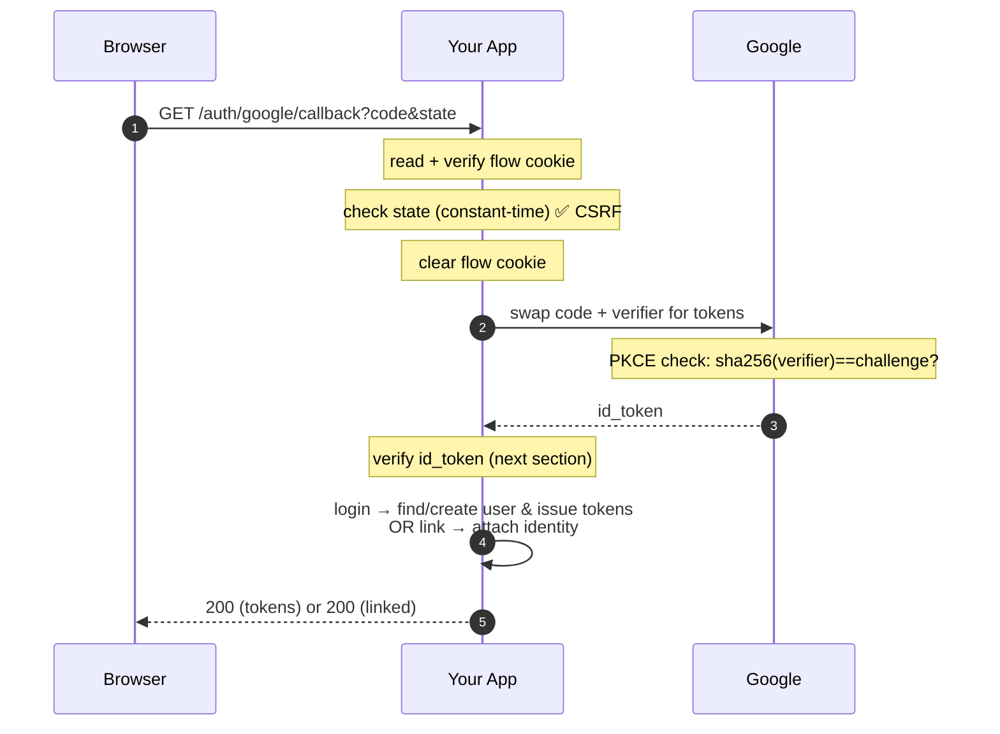
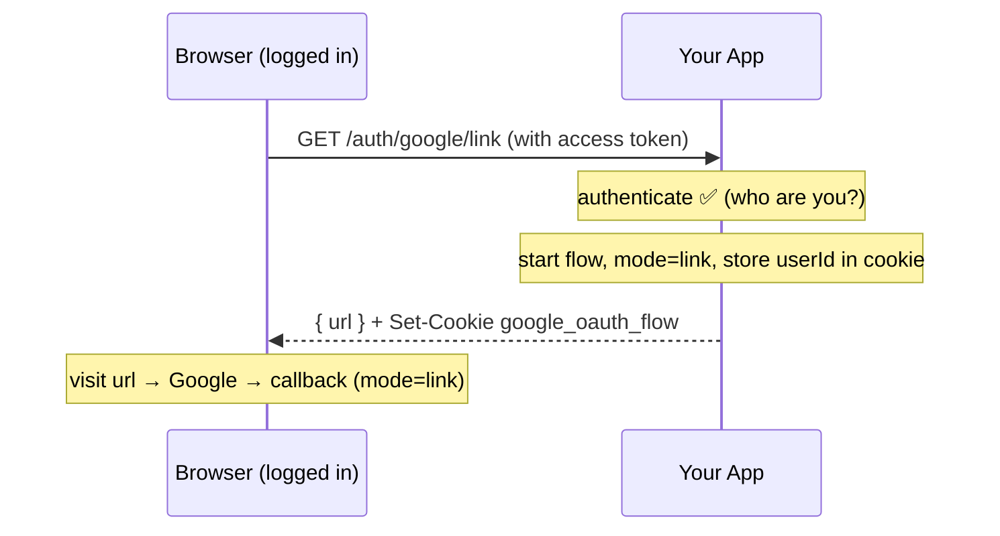
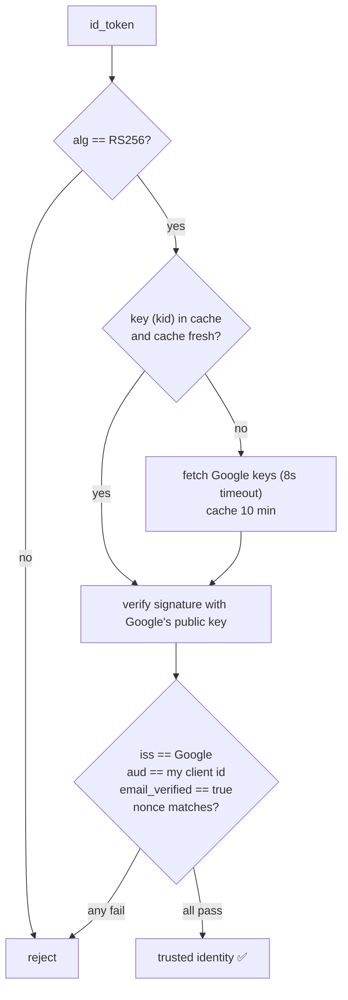
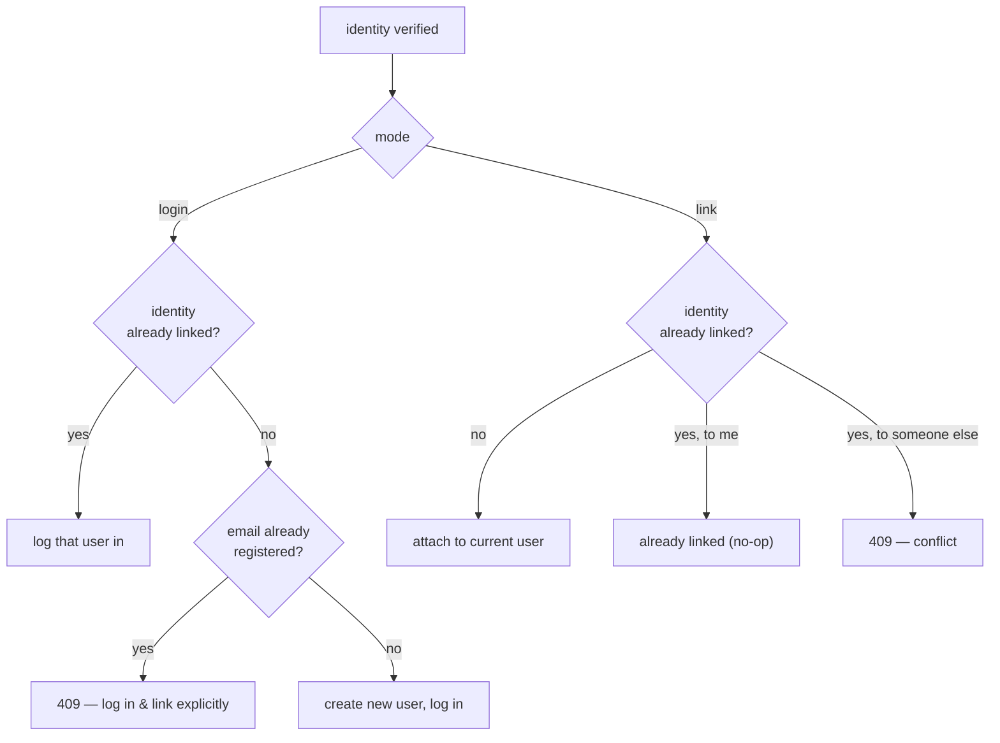
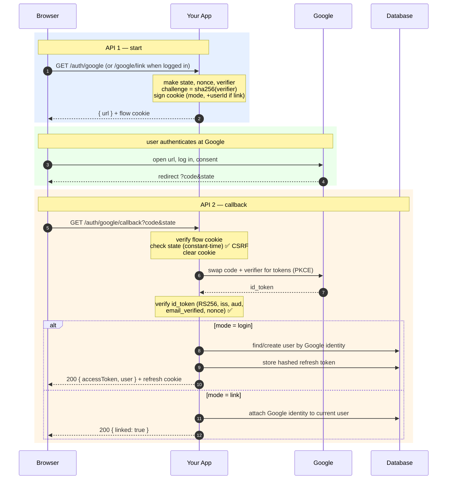

# Google OAuth — The Complete Teaching Guide

A self-contained guide to the three Google OAuth APIs in this project. You can understand the whole system by reading this alone, without opening any code.

It is written in a **"what is it / why is it there"** style, the same way the questions were explored in chat. It is also structured to work well as a study source for NotebookLM (short sections, plain language, clear headings, repeated key terms) so you can generate audio or study notes from it.

The three APIs:

```
GET /api/v1/auth/google           → start "Sign in with Google"
GET /api/v1/auth/google/callback  → Google sends the user back here
GET /api/v1/auth/google/link      → connect Google to an account you already own
```

---

## Table of contents

1. [The big idea in plain English](#big-idea)
2. [Why not just ask for the Google password?](#why-not-password)
3. [The cast of characters](#cast)
4. [The four secrets (and the attacks they stop)](#four-secrets)
5. [API 1 — GET /auth/google (start login)](#api-1)
6. [API 2 — GET /auth/google/callback (finish)](#api-2)
7. [API 3 — GET /auth/google/link (link account)](#api-3)
8. [How the identity token is checked](#verify-id-token)
9. [Login mode vs Link mode](#login-vs-link)
10. [Glossary (every term, plain words)](#glossary)
11. [Full end-to-end flow (all APIs, start to finish)](#full-flow)
12. [Interview Q&A (the "what & why" recap)](#qa)

---

## Big idea

OAuth answers **one question**: *"Is this person really the owner of this Google account?"* — and it answers it **without your app ever seeing their Google password**.

The trick is simple when you say it out loud:

> Your app sends the user to Google. Google checks their password. Google sends back a **signed proof** that says "yes, this is jane@example.com, and I verified it." Your app checks that proof is genuinely from Google, and then your app issues **its own** login tokens.

So Google does the hard, risky part (password checking), and your app just trusts a signed note from Google.



---

## Why not password

A beginner question: *why all this complexity — why not just let the user type their Google password into my app?*

Because that would be a disaster:

- Your app would **see and could store** the user's Google password. If your app is hacked, their Google account is gone too.
- Users (rightly) don't trust random apps with their Google password.
- Google would have no way to add protections like 2-factor auth, device checks, etc.

OAuth fixes this: the password is **only ever typed on Google's own page**. Your app never touches it. Your app only receives a signed "identity proof" afterward.

> **What it is:** a way to prove identity without handling the password.
> **Why it exists:** so a password breach in your app can't leak the user's Google account.

---

## Cast

Three parties are involved. Keep them straight and everything else makes sense.

| Party | Role |
|-------|------|
| **The user (browser)** | The person logging in. Carries messages between your app and Google. |
| **Your app (server)** | Wants to know who the user is. Issues its own tokens at the end. |
| **Google** | The trusted identity provider. Checks the password, signs the proof. |

A crucial detail: **the browser is the messenger.** Your server and Google mostly don't talk directly during the first steps — they pass notes *through* the user's browser (via redirects). That's why so many security checks exist: anything passing through the browser could be seen or tampered with by an attacker.

---

## Four secrets

At the start of every login, your app generates **four values**. Each one defends against a specific attack. This is the heart of the whole system, so take it slowly.

```
state     = random string      → "Did I start this login?"        (stops CSRF)
nonce     = random string      → "Is this proof fresh?"           (stops replay)
verifier  = random SECRET      → kept hidden                      (part of PKCE)
challenge = sha256(verifier)   → sent to Google                   (part of PKCE)
```

### 1. `state` — "Did I start this login?"

Your app makes a random `state`, remembers it, and sends it to Google. Google returns it unchanged at the end. Your app checks the returned value equals the saved one.

- If they match → this really is the login your app started.
- If they don't → someone forged the request. Reject.

> **Attack it stops: CSRF** (a malicious site tricking the browser into completing a login the user didn't intend).
> **Analogy:** you tear a ticket in half, keep one half, give Google the other. At the end the halves must fit.

### 2. `nonce` — "Is this proof fresh?"

Your app makes a random `nonce` and sends it to Google. Google **writes it inside the signed identity proof**. Your app checks the `nonce` inside the proof equals the one it sent.

- If an attacker replays an **old** identity proof from a past login, its `nonce` won't match the new one. Reject.

> **Attack it stops: replay** (reusing a stolen/old identity token).
> **Analogy:** you ask Google to write *today's* secret word inside the sealed letter. Yesterday's letter has the wrong word.

### 3 & 4. `verifier` + `challenge` — PKCE

This pair is the most important, and the trickiest. It protects the **authorization code**.

Background: Google doesn't hand your app tokens directly. It hands back a short **code**, and your app later swaps that code for tokens in a separate request. The danger: *what if an attacker intercepts the code?*

PKCE (say it "pixy") solves this with a one-way hash:

- `verifier` = a **secret** random string. Your app keeps it hidden and never sends it at the start.
- `challenge` = `sha256(verifier)`. Your app sends **only this hash** to Google when starting.
- Google stores the `challenge` next to the code it issues.
- Later, when your app swaps the code for tokens, it finally sends the real `verifier`.
- Google computes `sha256(verifier)` and checks it equals the stored `challenge`.

Because a hash can't be reversed, an attacker who steals the code (and even sees the challenge) still can't produce the verifier. The stolen code is useless to them.

> **Attack it stops: stolen authorization code.**
> **Analogy:** at the start you hand Google a locked padlock (challenge) and keep the only key (verifier). Anyone can grab the code, but without your key they can't open anything.

### Where these live: the flow cookie

All four values (plus `mode` and maybe `userId`) are packed into **one short-lived signed cookie** called `google_oauth_flow`. It lasts 10 minutes.

Why a signed cookie and not a database row or server session?

- **Stateless:** the server doesn't need to remember anything between the two requests. All the state rides along in the cookie.
- **Tamper-proof:** the cookie is a signed JWT, so if an attacker edits it, the signature breaks and it's rejected.
- **Short-lived:** 10 minutes is plenty to finish a login, and it auto-expires if abandoned.



---

## API 1

### `GET /api/v1/auth/google` — start "Sign in with Google"

**Purpose:** begin the login. The user is not signed in yet.

**What happens, step by step:**

1. The server checks Google OAuth is configured (client id, secret, callback URL all present). If not, it returns `503 OAUTH_UNAVAILABLE`.
2. It generates the four secrets: `state`, `nonce`, `verifier`, `challenge`.
3. It builds the Google sign-in URL, embedding: your app's client id, the callback URL, the requested scopes (`openid email profile`), the `state`, the `nonce`, and the `challenge`.
4. It packs `state`/`nonce`/`verifier`/`mode` into a signed JWT and sets it as the `google_oauth_flow` cookie.
5. It returns the Google URL as JSON: `{ "url": "https://accounts.google.com/..." }`.

**Important:** this endpoint does **not** redirect. It hands the URL back to the frontend, and the frontend decides when to send the user there. This gives a single-page app full control.

**Response — 200 OK**
```json
{ "url": "https://accounts.google.com/o/oauth2/v2/auth?client_id=...&state=...&code_challenge=..." }
```
Plus header: `Set-Cookie: google_oauth_flow=<signed JWT>; HttpOnly; Max-Age=600`.



---

## API 2

### `GET /api/v1/auth/google/callback` — Google sends the user back

**Purpose:** the destination Google redirects to after the user logs in. This is where the real work happens. One endpoint handles **both** login and link (it decides based on the `mode` saved in the cookie).

Google redirects the browser here with two query values: `?code=...&state=...`.

**What happens, step by step:**

1. **Read the flow cookie.** The server reads `google_oauth_flow` and verifies its JWT signature. If missing/expired/tampered → `401`.
2. **Check `state`** (CSRF). It compares the `state` from the URL against the `state` stored in the cookie, using a **constant-time comparison** (so timing can't leak the secret). Mismatch → `401`.
3. **Clear the flow cookie.** It's single-use; delete it immediately.
4. **Check the `code` exists.** Missing → `400`.
5. **Swap the code for tokens** (PKCE). The server makes a direct, server-to-server call to Google's token endpoint, sending the `code`, the client secret, and the **`verifier`**. Google checks `sha256(verifier) == challenge` it stored earlier. If good, Google returns an `id_token`.
6. **Verify the `id_token`.** (Full details in the next section.) Confirm it's genuinely signed by Google, meant for this app, for a verified email, and contains the matching `nonce`.
7. **Act based on `mode`:**
   - **login:** find or create the user, then issue your app's tokens.
   - **link:** attach the Google identity to the already-logged-in user.
8. **Respond.**

**On login success — 200 OK**
```json
{
  "message": "Google login successful",
  "data": {
    "accessToken": "eyJ...",
    "user": { "id": "...", "email": "jane@example.com", "roles": ["USER"] }
  }
}
```
Plus a `refreshToken` cookie.

**On link success — 200 OK**
```json
{ "message": "Google account linked", "alreadyLinked": false }
```

**Possible errors**

| Status | Meaning |
|--------|---------|
| 400 | `code` missing |
| 401 | bad/expired flow cookie, bad `state`, code rejected, or id_token failed verification |
| 409 | email already registered (login), or Google identity already linked elsewhere (link) |
| 503 | Google not configured, or Google's key service unreachable |



---

## API 3

### `GET /api/v1/auth/google/link` — connect Google to an account you already own

**Purpose:** a **logged-in** user wants to add "Sign in with Google" to their existing email+password account.

**What is different from API 1:**

- It requires the user to be **authenticated** (they send their access token). That's enforced by the `authenticate` step before the handler runs.
- The flow is started in `mode: "link"`, and the logged-in user's `userId` is baked into the signed flow cookie — so the callback knows **which account** to attach Google to.

**What happens, step by step:**

1. The `authenticate` step verifies the user's access token. No valid token → `401`.
2. The server starts a Google flow with `mode = "link"` and the current `userId`.
3. Same four secrets are generated and stored in the flow cookie (now also carrying `userId`).
4. Returns the Google URL as JSON, exactly like API 1.

The user then visits that URL, logs into Google, and Google redirects back to the **same callback** (API 2), which sees `mode: "link"` and attaches the identity instead of logging in.

**Response — 200 OK**
```json
{ "url": "https://accounts.google.com/o/oauth2/v2/auth?..." }
```

**Why this endpoint exists (important):** it is the *safe, deliberate* way to merge a Google identity with an existing account. The system refuses to merge automatically by email (that would be an account-takeover risk — see [Login vs Link](#login-vs-link)). So linking must be an explicit action by someone already proven to own the account.



---

## Verify id token

The `id_token` is a signed note from Google describing the user. Your app must not trust it until **every** check passes. This is the most security-critical part.

**What is an id_token?** A JWT (a signed, encoded JSON object) containing claims like: `sub` (the user's unique Google id), `email`, `email_verified`, `nonce`, `iss` (issuer), `aud` (audience).

**Why verify it so carefully?** Because it arrived through the browser and the token endpoint. An attacker could try to forge one. The signature + claim checks make forgery practically impossible.

**The checks, in order:**

1. **Algorithm must be `RS256`.** Pin it. Never accept `alg: none` or a different algorithm. (Stops "algorithm confusion" tricks.)
2. **Get Google's public key** (to check the signature). Google publishes a set of keys (a "JWKS"). The token header names which key (`kid`) signed it. The app:
   - Uses a **cached** copy of Google's keys if it's fresh (under 10 minutes) and contains the needed `kid`.
   - Otherwise fetches the keys from Google (with an 8-second timeout) and caches them for 10 minutes.
   - This caching avoids calling Google on every login, but still refreshes early if Google rotated to a new key.
3. **Verify the signature** using that public key. If it doesn't verify → reject.
4. **`iss` (issuer)** must be Google (`accounts.google.com`). Confirms Google issued it.
5. **`aud` (audience)** must equal **your** client id. Confirms the token was minted for *your* app, not some other app.
6. **`email_verified` must be true.** Google confirmed the user actually owns the email.
7. **`nonce` must equal the one you sent.** Ties this token to *this* login attempt (stops replay).

If all pass, the identity is trusted: you now know the user's Google `sub` and `email`.



---

## Login vs Link

One callback, two outcomes, decided by `mode`.

### `mode: "login"`
The user is signing in (or signing up) with Google.

- If this Google identity is already connected to a user → log that user in.
- If not, and **no** account uses that email yet → create a brand-new user and log them in.
- If not, but an account with that email **already exists** (a password account) → **refuse** with `409`.

**Why refuse instead of merging?** This is the key safety decision.

> A matching email is **not proof** that the person controls that existing account. If the app auto-merged by email, an attacker could create a Google account with your email and slip into your existing account. So the app says: *"that email already exists — log in normally first, then link Google explicitly."*

### `mode: "link"`
The user is already logged in and wants to attach Google.

- If this Google identity isn't linked to anyone → attach it to the current user. Done.
- If it's already linked to **this same** user → no-op, return "already linked."
- If it's linked to a **different** user → `409` (one Google identity can't belong to two accounts).



---

## Glossary

Plain-language meaning of every term used.

| Term | What it means |
|------|---------------|
| **OAuth 2.0** | A standard for letting an app act on a user's behalf without their password. |
| **OpenID Connect (OIDC)** | A layer on top of OAuth that adds *identity* (the `id_token`). This project uses it. |
| **Authorization Code flow** | Google returns a short `code`; the server swaps it for tokens in a separate, secure call. |
| **PKCE** (pixy) | A verifier/challenge hash pair that proves the party redeeming the code is the one who started. |
| **state** | Random value echoed back to detect forged logins (CSRF). |
| **nonce** | Random value embedded in the id_token to detect replays. |
| **verifier** | The PKCE secret, kept by the server. |
| **challenge** | `sha256(verifier)`, sent to Google at the start. |
| **id_token** | A signed JWT from Google describing the user (sub, email, etc.). |
| **access token** | Your app's short-lived token proving who the user is on each request. |
| **refresh token** | Your app's long-lived token used to get new access tokens; stored as a cookie. |
| **sub** | Google's permanent unique id for the user — the real "who is this." |
| **iss / aud** | Issuer (who made the token) / Audience (who it's for). Both are checked. |
| **JWKS** | Google's published set of public keys used to verify its signatures. |
| **kid** | Key id — tells you which of Google's keys signed a given token. |
| **scope** | What you're asking for. Here: `openid email profile`. |
| **flow cookie** | `google_oauth_flow`: a signed, 10-minute cookie holding the four secrets + mode. |
| **mode** | `login` (sign in) or `link` (attach Google to an existing account). |
| **CSRF** | An attack where a malicious site makes your browser do something you didn't intend. |
| **replay attack** | Reusing a captured old token/message to impersonate someone. |
| **constant-time compare** | Comparing secrets so the time taken never reveals how much matched. |

---

## Full flow

The complete journey, all three APIs, from the first click to a logged-in user. Read this once and the whole system fits together.

### The story in words

1. **User clicks "Sign in with Google."** The frontend calls `GET /auth/google`.
2. The server makes four secrets (`state`, `nonce`, `verifier`, `challenge`), stores the first three plus `mode` in a signed 10-minute cookie, and returns a Google URL (with `state`, `nonce`, `challenge` inside it).
3. **The browser goes to Google.** The user logs in on Google's own page (your app never sees the password).
4. **Google redirects back** to `GET /auth/google/callback?code&state`.
5. The server verifies the flow cookie, checks the returned `state` matches (CSRF), and clears the cookie.
6. The server **swaps the code** for tokens by calling Google directly, sending the `verifier` (PKCE). Google checks `sha256(verifier) == challenge` and returns an `id_token`.
7. The server **verifies the id_token**: RS256 signature via Google's cached public keys, plus `iss`, `aud`, `email_verified`, and `nonce` all checked.
8. The server looks at `mode`:
   - **login:** find the user by Google identity, or create a new one (refusing if the email already has a password account). Then it issues an **access token** (JSON) and a **refresh token** (cookie).
   - **link:** attach the Google identity to the already-logged-in user (started via `GET /auth/google/link`).
9. **Done.** On login, the user is signed in with your app's own tokens. On link, their account now also works with Google next time.

### The complete diagram



---

## Q&A

A recap in question-and-answer form — the same "what is it / why is it there" questions worth being able to answer.

**Q: Why does the app never see the Google password?**
So a breach of your app can't compromise the user's Google account. The password is only ever entered on Google's page.

**Q: What is `state` and why?**
A random value echoed back by Google so the app can confirm *it* started this login. Stops CSRF — forged login completions.

**Q: What is `nonce` and why?**
A random value Google embeds inside the id_token. The app checks it matches what it sent, so an old/replayed id_token is rejected. Stops replay attacks.

**Q: What is PKCE (`verifier`/`challenge`) and why?**
The app keeps a secret `verifier` and sends only its hash (`challenge`) at the start. At the end it reveals the `verifier`, and Google checks the hash matches. This makes a stolen authorization code useless, because the thief doesn't have the verifier.

**Q: Why send the hash and not the verifier at the start?**
The challenge travels through the browser where it could be seen. A hash can't be reversed, so seeing it doesn't reveal the secret verifier.

**Q: Why is the flow state in a signed cookie instead of a server session?**
It keeps the server stateless (nothing to remember between requests), the signature makes it tamper-proof, and the 10-minute expiry cleans it up automatically.

**Q: Why use a constant-time comparison for `state`?**
A normal `===` returns faster when values differ early, which leaks how much matched and enables a timing attack to guess the secret. Constant-time comparison always takes the same time, leaking nothing.

**Q: Why cache Google's public keys (JWKS)?**
Verifying every id_token needs Google's keys. Downloading them on every login would be slow and could get rate-limited. The app caches them for 10 minutes, but refreshes early if a token uses a key id it hasn't seen (handling Google's key rotation).

**Q: Why check `aud` (audience) on the id_token?**
To confirm the token was issued for *your* app's client id, not some other app that also uses Google. Prevents a token minted elsewhere from being accepted here.

**Q: What is `mode` and why two values?**
`login` signs a user in (or signs them up); `link` attaches Google to an account the user already owns. The callback uses `mode` to decide what to do.

**Q: Why refuse to auto-merge a Google login with an existing email account?**
A matching email isn't proof of ownership. Auto-merging would let an attacker with a same-email Google account hijack the existing account. So linking must be explicit, done while already logged in, via `/auth/google/link`.

**Q: What does the user get at the very end?**
On login: an access token (in the JSON body) and a refresh token (in an httpOnly cookie) — the same token pair as normal email/password login. On link: a confirmation that Google is now connected.

---

### Related
- Password login, token strategy, refresh rotation, `/me`: `docs/api/auth.md`
