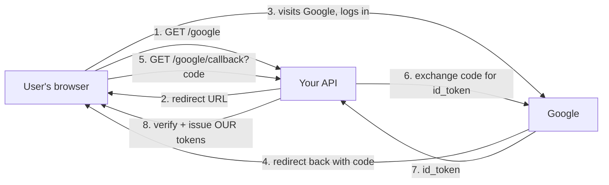
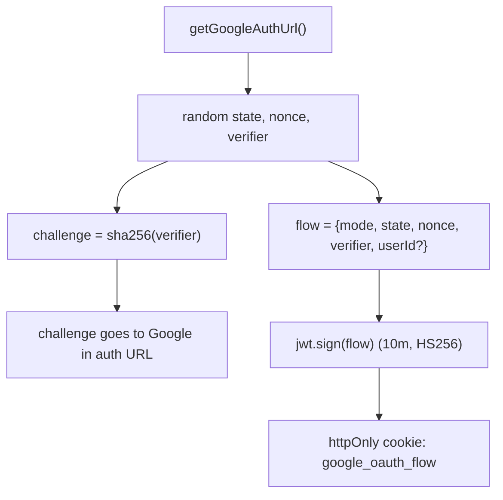
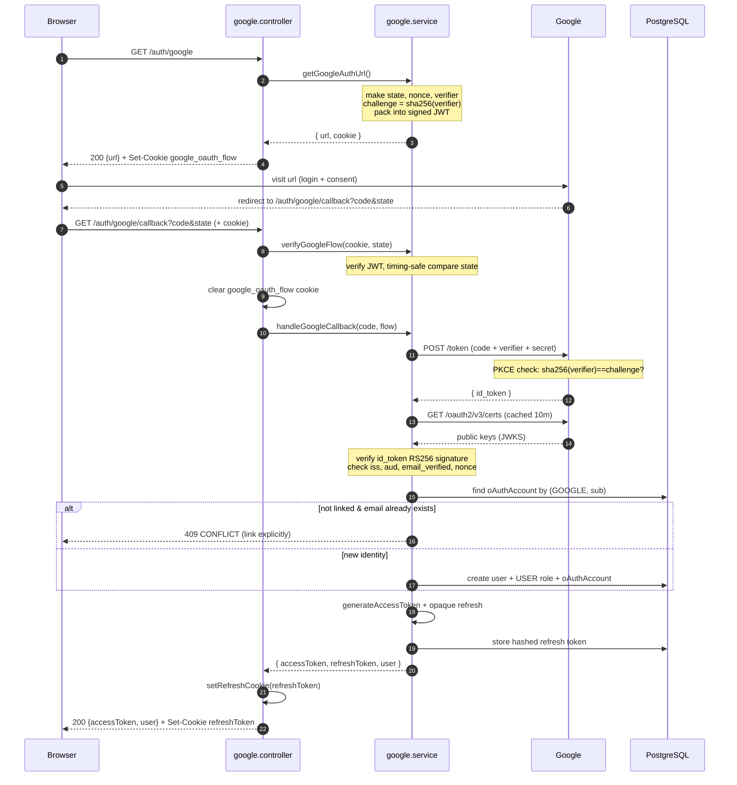
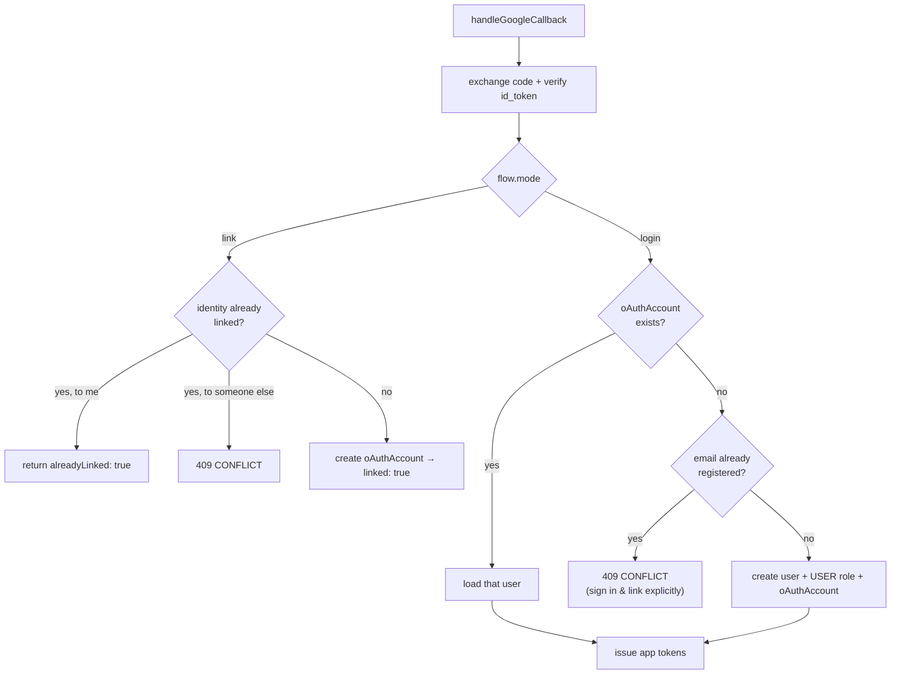
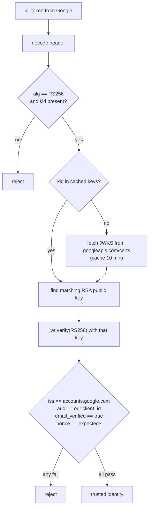
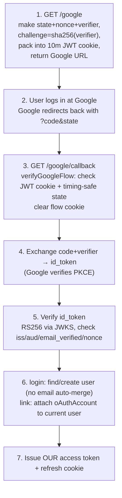

# Google OAuth

End-to-end documentation for the Google sign-in / account-linking flow in this repo.

This describes the code **as it actually is** in `google.controller.ts` and `google.service.ts`. It's written to be both a reference you can open any time and interview-prep: it explains *what* happens, *why* each security step exists, and *where* in the code it lives.

```
router.get("/google",          googleAuthUrlHandler);    // start login
router.get("/google/callback", googleCallbackHandler);   // Google redirects back here
router.get("/google/link",     authenticate, googleLinkStartHandler); // link to existing account
```

---

## Table of contents

1. [The 30-second mental model](#mental-model)
2. [Which OAuth flow is this?](#which-flow)
3. [The actors and the secrets](#actors-and-secrets)
4. [Full end-to-end flow (login)](#full-flow-login)
5. [Endpoints](#endpoints)
6. [The two modes: login vs link](#login-vs-link)
7. [How the ID token is verified](#id-token-verification)
8. [Security design notes (interview gold)](#security-notes)
9. [Configuration](#configuration)
10. [Quick revision flow](#quick-revision-flow)

---

## Mental model

OAuth here answers one question: **"Is this person really the owner of this Google account?"** — without you ever seeing their Google password.

The trick: Google does the password check. Your server and Google exchange a few signed messages to prove it happened, and at the end your server issues **its own** tokens (the same access-token + refresh-cookie pair the normal login uses).

> The one sentence to remember: *We never handle the user's Google password. We send the user to Google, Google sends back a signed proof of identity (an ID token), we verify that proof, then we mint our own app tokens.*



---

## Which flow

This is the **OAuth 2.0 Authorization Code flow with PKCE and OpenID Connect**. Breaking down that mouthful:

| Term | Meaning in this code |
|------|---------------------|
| **Authorization Code** | Google returns a short-lived `code`, not tokens directly. The server swaps the `code` for tokens over a back-channel. |
| **PKCE** (Proof Key for Code Exchange) | A `verifier`/`challenge` pair that proves the party redeeming the `code` is the same party that started the flow. Blocks stolen-code attacks. |
| **OpenID Connect (OIDC)** | The layer that gives you an `id_token` (a signed JWT describing *who the user is*), on top of plain OAuth. We ask for scope `openid email profile`. |

> Interview note: plain OAuth is about *authorization* (access to resources). **OpenID Connect** adds *authentication* (identity) via the `id_token`. This repo cares about identity, so it uses OIDC.

---

## Actors and secrets

Four pieces of state get created at the start and checked at the end. Knowing them makes the whole flow click.

| Name | Created where | Stored where | Purpose |
|------|--------------|--------------|---------|
| `state` | `getGoogleAuthUrl` (random 24 bytes) | Signed JWT cookie `google_oauth_flow` | **CSRF defense** — the callback's `state` must match what we issued |
| `nonce` | `getGoogleAuthUrl` (random 24 bytes) | Same cookie | **Replay defense** — must appear inside Google's `id_token` |
| `verifier` | `getGoogleAuthUrl` (random 32 bytes) | Same cookie | **PKCE** — secret sent only at code-exchange time |
| `challenge` | `sha256(verifier)` | Sent to Google in the auth URL | **PKCE** — Google stores it and later checks `sha256(verifier) == challenge` |

The clever part: all of `state`, `nonce`, `verifier` (and `userId` in link mode) are packed into **one short-lived (10 min) signed JWT** and dropped in an `httpOnly` cookie called `google_oauth_flow`. The server stays **stateless** — no DB row or session store needed to remember the in-flight OAuth attempt.



---

## Full flow login

The complete happy path for a **new user signing in with Google**, with the exact functions involved.



Notice the ending: once Google's identity is verified, it funnels into the **same token machinery as normal login** — a JWT access token in the body plus an opaque, hashed refresh token in an `httpOnly` cookie. (See `docs/api/auth.md` for that token strategy.)

---

## Endpoints

### GET /auth/google — start login

Returns a URL for the browser to visit, and sets the `google_oauth_flow` cookie.

**Response — `200 OK`**
```json
{ "url": "https://accounts.google.com/o/oauth2/v2/auth?client_id=...&state=...&code_challenge=..." }
```
Plus `Set-Cookie: google_oauth_flow=<signed JWT>; HttpOnly; SameSite=Lax; Max-Age=600`.

The frontend then does `window.location = url` (or opens it). This endpoint does **not** redirect itself — it hands the URL back so the SPA controls navigation.

---

### GET /auth/google/link — start linking (protected)

Same as above but `mode: "link"` and requires an authenticated user (`authenticate` middleware). The current `userId` is baked into the flow JWT so the callback knows which account to attach the Google identity to.

**Response — `200 OK`** — same `{ url }` shape.

---

### GET /auth/google/callback — Google redirects here

Google sends the browser back here with `?code=...&state=...`. This single endpoint handles **both** login and link, deciding based on the `mode` stored in the flow cookie.

**Login result — `200 OK`**
```json
{
  "message": "Google login successful",
  "data": {
    "accessToken": "eyJ...",
    "user": { "id": "...", "email": "jane@example.com", "roles": ["USER"] }
  }
}
```
Plus a `refreshToken` cookie.

**Link result — `200 OK`**
```json
{ "message": "Google account linked", "alreadyLinked": false }
```

**Errors**

| Status | Code | When |
|--------|------|------|
| 400 | `BAD_REQUEST` | `code` missing |
| 401 | `UNAUTHORIZED` | Missing/invalid/expired flow cookie, bad `state`, code rejected, or `id_token` fails verification |
| 409 | `CONFLICT` | Email already has a password account (login mode), or Google identity already linked elsewhere (link mode) |
| 503 | `OAUTH_UNAVAILABLE` | Google OAuth env vars not configured, or Google's key endpoint is down |

---

## Login vs link

One callback, two behaviors — driven by `flow.mode`.



**The important security decision (interviewers love this one):**

In **login** mode, if the Google email matches an existing **password** account, the code **refuses** to auto-merge:

```typescript
// A matching email is NOT proof that an existing password account belongs to this identity.
if (matching) throw new ConflictError("Email is already registered; sign in and link Google explicitly");
```

> Why? **Account takeover prevention.** If you auto-linked by email, an attacker who creates a Google account with your email (or exploits an unverified-email provider) could hijack your existing account. The safe path: make the user log in with their password first, *then* explicitly link Google via `/auth/google/link`.

---

## ID token verification

This is the most security-critical function (`verifyGoogleIdToken`). The `id_token` is a JWT **signed by Google with RS256**. We don't trust it until every check passes.



Each check and why it matters:

1. **`alg === "RS256"`** — pin the algorithm. Never accept a token that says `alg: none` or a symmetric alg. Blocks algorithm-confusion attacks.
2. **Fetch Google's public keys (JWKS)** from `googleapis.com/oauth2/v3/certs`, matched by `kid` (key id). **Cached for 10 minutes** so you don't hit Google on every login — but the cache is refreshed if an unknown `kid` shows up (Google rotates keys).
3. **`iss`** must be `accounts.google.com` — the token really came from Google.
4. **`aud`** must equal **our** `client_id` — the token was minted for *this* app, not some other app that also uses Google.
5. **`email_verified === true`** — Google confirmed the user owns the email. We reject unverified emails.
6. **`nonce`** must equal the one we generated at the start — ties this `id_token` to *this* specific login attempt, blocking replay of an old token.

---

## Security notes

A skimmable list before an interview. Everything here is in the code.

1. **Authorization Code + PKCE** — the `code` alone is useless without the `verifier`; Google checks `sha256(verifier) == challenge`. Defeats intercepted-code attacks.
2. **`state` with timing-safe compare** — CSRF defense on the callback. Uses `crypto.timingSafeEqual`, not `===`, to avoid timing side-channels.
3. **`nonce` echoed in the id_token** — replay defense, ties the identity token to one login attempt.
4. **Stateless flow via signed, short-lived (10m) JWT cookie** — no server-side session store; tampering is caught by the HS256 signature; it expires fast.
5. **`httpOnly` + `SameSite=Lax` + `Secure`-in-prod** on the flow cookie — JS can't read it, and it's cleared immediately after the callback consumes it.
6. **Full id_token verification** — RS256 pinned, JWKS by `kid`, `iss`/`aud`/`email_verified`/`nonce` all checked.
7. **No implicit account merge by email** — prevents account takeover; requires explicit linking.
8. **`email_verified` required** — never trust an unverified Google email.
9. **Separate JWT issuer/audience for the flow cookie** (`backend-api-oauth` / `google-oauth-flow`) — a flow cookie can never be mistaken for an app access token, even though both are signed with the same secret.
10. **Timeouts on all outbound calls to Google** (`AbortSignal.timeout`) — the token exchange (10s) and key fetch (8s) can't hang your request forever.
11. **Graceful "not configured" state** — if env vars are missing, returns `503 OAUTH_UNAVAILABLE` instead of crashing.
12. **Reuses the standard token machinery** — Google logins end with the same opaque, hashed, rotating refresh token as password logins.

---

## Configuration

Env vars (all validated in `config/env.ts`, all optional so the app boots without OAuth):

| Variable | Example | Notes |
|----------|---------|-------|
| `GOOGLE_CLIENT_ID` | `xxxx.apps.googleusercontent.com` | From Google Cloud Console. If it contains `"placeholder"`, OAuth is treated as unconfigured. |
| `GOOGLE_CLIENT_SECRET` | `GOCSPX-...` | The confidential client secret. |
| `GOOGLE_CALLBACK_URL` | `https://api.myapp.com/auth/google/callback` | Must exactly match an authorized redirect URI in the Google console. |
| `CORS_ORIGINS` | `https://myapp.com` | Used elsewhere for origin checks. |

If any are missing (or the client id is a placeholder), `requireConfiguration()` throws `503 OAUTH_UNAVAILABLE` and the OAuth endpoints are effectively off.

---

## Quick revision flow

The 60-second recap.



**One-liner per endpoint:**

- **`GET /auth/google`** → returns Google URL, sets the signed flow cookie. Login mode.
- **`GET /auth/google/link`** → same, but authenticated; remembers your `userId` to link later.
- **`GET /auth/google/callback`** → verifies state + id_token, then either logs you in (issues app tokens) or links the account.

**The three sentences that answer 80% of follow-up questions:**

1. *What stops a stolen `code`?* **PKCE** — the attacker doesn't have the `verifier`, and Google checks `sha256(verifier)` against the `challenge` we sent at the start.
2. *How is the server stateless during the flow?* The `state`/`nonce`/`verifier` live inside a short-lived signed JWT in an httpOnly cookie, not a session store.
3. *Why not auto-login when the Google email matches an existing account?* Account-takeover risk — a matching email isn't proof of ownership, so we require an explicit link after a normal login.

---

### Related
- Token strategy, refresh rotation, and the `/me` route: `docs/api/auth.md`
