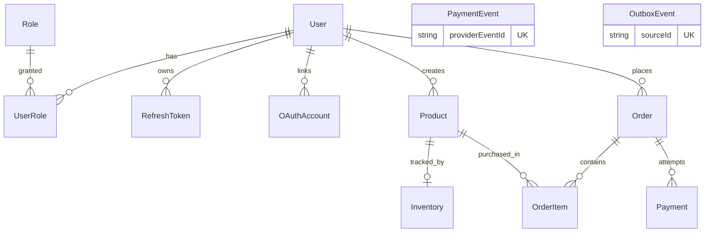

# Database schema & invariants

Source of truth: `prisma/schema.prisma` and migrations. PostgreSQL is the transactional system of record.

## Central tables

| Model | Important constraints / fields |
|---|---|
| `User` | Unique email, status `ACTIVE/DISABLED`; nullable password hash for Google-only users |
| `Role` / `UserRole` | Unique role name; composite primary key `(userId,roleId)` |
| `RefreshToken` | **Only SHA-256 digest** stored as `tokenHash UNIQUE`; expiry + revocation timestamp |
| `OAuthAccount` | Unique `(provider,providerUserId)`; never use email alone for implicit account linking |
| `Product` | Decimal price snapshot source, currency and `ACTIVE/INACTIVE` status |
| `Inventory` | Unique `productId`, nonnegative available and reserved counts via DB CHECK constraints |
| `Order` | `PENDING_PAYMENT`, `PAID`, `CANCELLED`, `EXPIRED`, expiry and user owner |
| `OrderItem` | Quantity > 0; `unitPrice` and `lineTotal` snapshots from server-side product prices |
| `Payment` | Unique nullable Stripe session and payment intent IDs; bound to order and amount/currency |
| `PaymentEvent` | Unique `providerEventId`, used for idempotent webhook processing |
| `OutboxEvent` | Unique `sourceId`, event/payload, published timestamp, retry attempt count |

## Transaction boundaries

1. **Register user:** create user + default role + outbox in one transaction; password hash computed before transaction.
2. **Order creation:** check product, conditionally reserve each inventory item using `updateMany ... availableQuantity >= qty`; create order + items + outbox in one transaction. Reject duplicate product IDs.
3. **Order cancellation:** conditional transition from `PENDING_PAYMENT`, reject any pending Stripe payment, release inventory conditionally within same transaction.
4. **Payment webhook:** signed event dedup, session binding, amount/currency check, conditional order transition, stock finalization and notification outbox in one transaction.
5. **Refresh rotation:** conditional old-token consumption + new hashed-token insert in one transaction.

## Index choices

`User.email`, `RefreshToken.tokenHash`, `OAuthAccount(provider,providerUserId)`, `Inventory.productId`, `Order(userId,createdAt DESC)`, `Payment.stripeSessionId`, `PaymentEvent.providerEventId`, and `OutboxEvent(publishedAt,createdAt)` support common lookups and worker polling. Profile actual query performance using EXPLAIN before adding speculative indexes.

### Known schema follow-ups

- No automatic lifecycle sweeper yet for abandoned/expired Stripe Checkout; reconcile before releasing stock.
- Currency mismatch across order items is rejected; actual provider capability/currency-specific decimal rules should be validated before expanding beyond USD-like minor units.
- Historical order price remains in `OrderItem` even if current catalog price changes.
