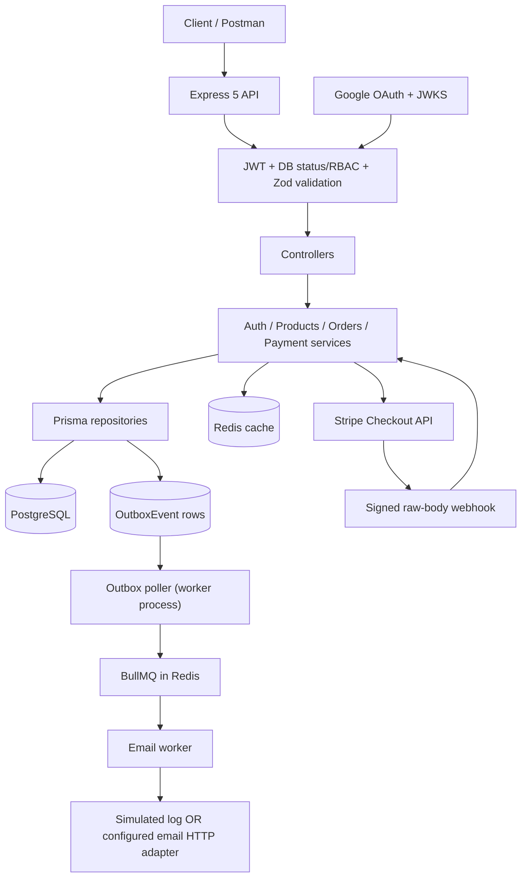
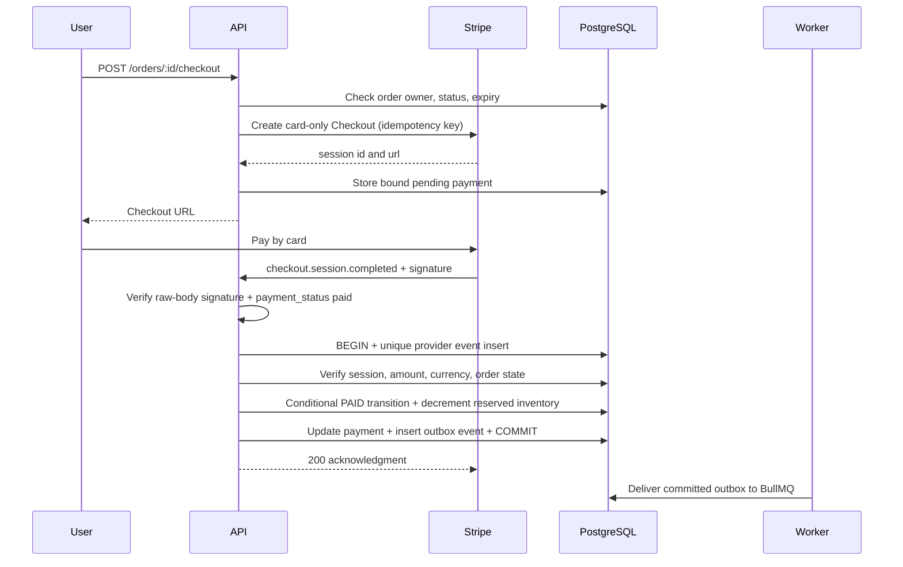

# Architecture overview

## Responsibility layers

HTTP requests pass through security headers, CORS, cookie parsing, correlation ID, request logging, raw Stripe body parser where applicable, bounded JSON parser and the routed controller. Domain services enforce business rules. Prisma repositories own DB access; Redis is a cache, not the source of truth. Workers are independently started. The code is **modular layered architecture**, not isolated microservices.



## Creation/reservation transaction

```mermaid
sequenceDiagram
    participant U as Authenticated user
    participant A as Orders API
    participant DB as PostgreSQL
    participant W as Worker
    U->>A: POST /api/v1/orders {items}
    A->>DB: BEGIN
    loop For each item
      A->>DB: Conditional UPDATE inventory (available >= quantity)
      DB-->>A: affected row count
    end
    A->>DB: Create order + price snapshots + outbox event
    A->>DB: COMMIT
    A-->>U: Pending order
    W->>DB: Read unpublished outbox rows
    W->>W: Add job to BullMQ; mark outbox published
```

## Checkout and signed webhook



### State guarantees and limitations

- Pending order creation and stock reservation are atomic in PostgreSQL.
- Checkout uses server-side price snapshots and single-purpose card payment flow.
- Webhook event uniqueness and a conditional order transition prevent duplicate inventory finalization.
- A genuine paid event for a **cancelled/expired** order fails with a reconciliation-required conflict, rather than silently restocking/confirming. Such cases require operations support.
- Cancellation is rejected after a Checkout has begun, until the external payment state can be reconciled.
- The outbox protects against losing the **enqueue request** when the API commits but Redis is offline. It does not itself guarantee exactly-once email delivery.
- Redis failures should not invalidate PostgreSQL reads/writes where cache use is optional.

### Directory guide

- `src/modules/auth`: identity, session rotation, Google flow
- `src/modules/products`: Zod input, product CRUD, cache use
- `src/modules/orders`: stock reservation, order access/cancellation
- `src/modules/payments`: Checkout and webhook event processing
- `src/common/cache`: cache-aside and invalidation
- `src/common/queue`: BullMQ adapter and outbox poller
- `src/workers/email.worker.ts`: queued email simulation or configured HTTP transport
- `src/middlewares`: auth, RBAC, request ID, logger, rate limiting
