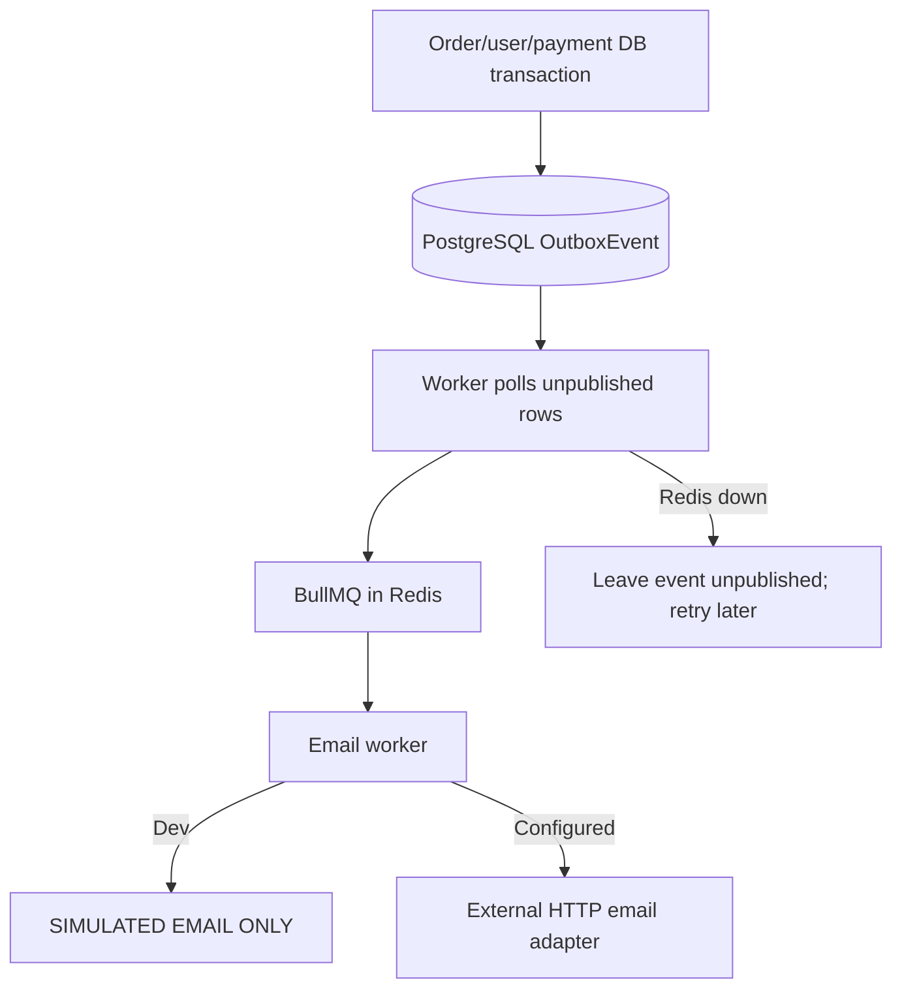

# Transactional outbox + BullMQ + email worker

Real code: `src/common/queue/bullmqQueue.service.ts`, `outbox.service.ts`, `src/workers/email.worker.ts`, Prisma `OutboxEvent`.

Outbox events:

- `USER_REGISTERED` — written in user-creation transaction.
- `ORDER_CREATED` — written in inventory/order transaction.
- `PAYMENT_CONFIRMED` — written in verified webhook transaction.

The worker polls about every 3 seconds. It publishes a BullMQ job using **outbox ID as jobId**, then sets `publishedAt` and increments attempts. Failed publishes remain unpublished. Worker jobs use bounded retries and exponential backoff. A crash after enqueue but before publishedAt can produce a duplicate; this is an **at-least-once** system, not exactly-once delivery.

Email modes:

- `EMAIL_TRANSPORT=log` (default): safe for learning; does **not send** messages. In production it fails rather than claim a real send.
- `EMAIL_TRANSPORT=webhook`: sends JSON `{to,subject,text}` to the configured `EMAIL_API_URL` using bearer `EMAIL_API_KEY` and an `Idempotency-Key` header. Your provider adapter must be configured, secured and tested; no vendor-specific implementation is bundled.

Operational gaps: there is no provider-level delivery receipt/history, dead-letter reconciliation dashboard or retention cleanup yet. Deploy both API and worker; starting the API alone won't drain outbox records. Redis downtime does not undo committed PostgreSQL orders/payments.
