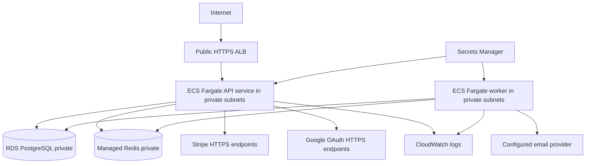

# AWS deployment plan (reference only — NOT DEPLOYED)

**Recommended target:** ECR, ECS Fargate (separate API and worker tasks), RDS PostgreSQL, private Redis service, CloudWatch Logs/metrics/alarms, Secrets Manager, HTTPS ALB/ACM.

## Deployment tasks

1. Estimate AWS cost (ALB, RDS, managed Redis, ECS, data transfer and NAT/private endpoints). Do **not** create cloud resources without budget approval.
2. Provision a VPC spanning at least two AZs for reliability; public subnets for ALB, private subnets for ECS and RDS, restrictive Security Groups. RDS accepts only ECS tasks on PostgreSQL port; Redis only ECS tasks on its port.
3. Build and scan Docker image; push to ECR with immutable digest/version tag.
4. Store `DATABASE_URL`, `REDIS_URL`, `JWT_SECRET`, Stripe secrets, Google client secrets, email keys in Secrets Manager; grant only task-specific read permissions with IAM task roles.
5. Execute `npx prisma migrate deploy` as a **single controlled release step**, not concurrently in multiple ECS tasks.
6. Deploy API task using `node dist/server.js`, worker task using `node dist/workers/email.worker.js`. Health endpoint `/health/live`, readiness `/health/ready`.
7. Configure ACM TLS and ALB HTTPS forwarding. Lock down CORS origins, `PUBLIC_BASE_URL`, Google callback URL and Stripe webhook endpoint.
8. Monitor HTTP errors/latency, queue failed jobs, Redis/Pg health, and unpublished outbox age. Use CloudWatch retention, backups, alarms and a tested rollback plan.
9. In **Stripe test mode**, complete a real API → Checkout → signed webhook → committed order → outbox → worker walkthrough. Validate failure paths before production.

## IAM / networking principles

IAM grants AWS API actions to ECS tasks (e.g. Secrets Manager/CloudWatch). Security Groups determine network reachability (ALB → API, API/worker → PostgreSQL and Redis). They are **separate layers**. Never expose port 5432 or Redis port 6379 publicly.

## Rollback and backups

Revert application image to previous digest. Migrations may not be backward-compatible; plan additive/expand-and-contract schema changes and test rollback before applying destructive changes. Configure and test database backups and point-in-time recovery. Rotate provider tokens if compromise is suspected.

## Not yet done

Cloud resources, ECR repository, ECS task definitions, security groups, secrets, IAM policies, infrastructure-as-code, CloudWatch alarm resources and real end-to-end Stripe/Google flows were **not** created or verified by this ZIP modification. Follow this runbook in your own AWS account when ready.
