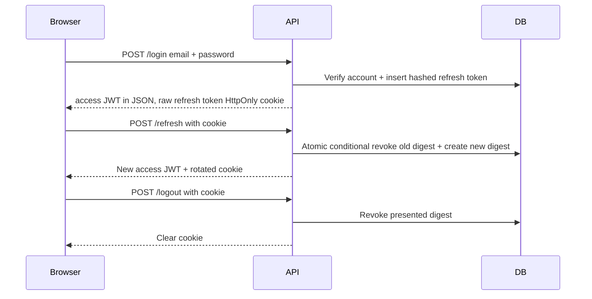

# Authentication, refresh tokens and Google OAuth

## Password login

- `POST /api/v1/auth/register`: validate and normalize email, Argon2 password hash, assign `USER`, create transactional outbox record.
- `POST /api/v1/auth/login`: verify password and active account; issue a short-lived `HS256` JWT with controlled issuer/audience; store a high-entropy opaque refresh token as SHA-256 digest.
- Successful login returns only the access JWT + user profile in JSON; the **raw refresh token is HttpOnly cookie-only** (`refreshToken`).
- `POST /api/v1/auth/refresh`: reads cookie; in one DB transaction conditionally revokes the old digest and inserts the new digest. One concurrent reuse can win; the other must fail. Response returns access token and a rotated cookie, no plaintext refresh token JSON.
- `POST /api/v1/auth/logout`: revokes the **presented session**, clears cookie. An existing access JWT remains usable until expiry; all-session revocation is not implemented.
- `GET /api/v1/auth/me`: access JWT required, current user loaded from DB. Disabled users denied and actual role assignments consulted instead of trusting stale JWT role claims.

Security policies:

- Bearer JWT must have correct signature, expiry, issuer, audience, HS256 algorithm, and valid user ID/email/role structure.
- Cookie is `HttpOnly` with `SameSite=Lax`; `Secure` in production. Cookie-backed mutations reject an unexpected browser `Origin`. Set precise `CORS_ORIGINS`; this is not a general substitute for full CSRF analysis in arbitrary frontends.
- Local authentication rate limiter is process-memory only (20 attempts / 15 min per IP), not suitable alone for multi-node production; use shared gateway/WAF enforcement.
- `.env` contains secrets and is excluded from provided ZIP and Git. Avoid logging passwords, raw tokens and provider credentials.

## Google OAuth / OIDC

1. `GET /api/v1/auth/google` generates a randomized OAuth state, PKCE verifier/challenge and nonce. Signed flow data is saved in a short-lived HttpOnly cookie (`google_oauth_flow`). The JSON response contains the authorization URL.
2. Browser navigates to the URL and authenticates with Google.
3. Google redirects to `GET /api/v1/auth/google/callback?code=...&state=...`. The backend validates signed cookie + state; exchanges the code with `code_verifier` and client secret.
4. Google `id_token` is verified **cryptographically** against Google's published JWKS public keys and checked for allowed issuer, audience, expiry, matching nonce, verified email and stable `sub`.
5. Existing `(provider='GOOGLE',providerUserId=sub)` signs in to that user. Unknown identity can create a Google-only account unless the email already belongs to a local user; email collision requires explicit linking.
6. Linking: authenticated caller requests `GET /api/v1/auth/google/link` with bearer JWT, navigates to the returned URL, completes the same verified callback. The signed context binds the previously authenticated user; no raw identity ID is accepted from request body.

Never accept `mockSub`, `mockEmail`, decoded-but-unverified JWT payload or direct `googleSub` to establish a user identity. The previous ZIP did so; that path was removed.

**Configuration:** `GOOGLE_CLIENT_ID`, `GOOGLE_CLIENT_SECRET`, `GOOGLE_CALLBACK_URL` required for use. Missing credentials return 503, not a fake successful login. The browser must preserve the OAuth cookie across the authorization redirect; HTTPS is required in production.

### Remaining security tasks

- Add Redis/gateway-wide rate limiting, account recovery, security key rotation, password reset, session device listings, user-level logout-all, and automated OIDC integration tests in a network-enabled environment.
- Consider requiring recent password reauthentication before linking a high-value identity.
