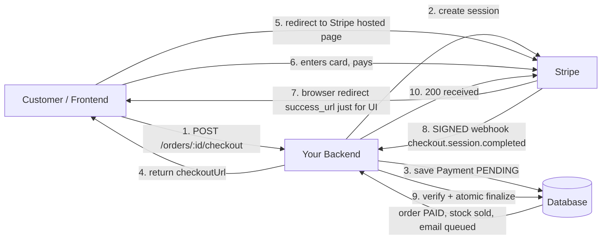
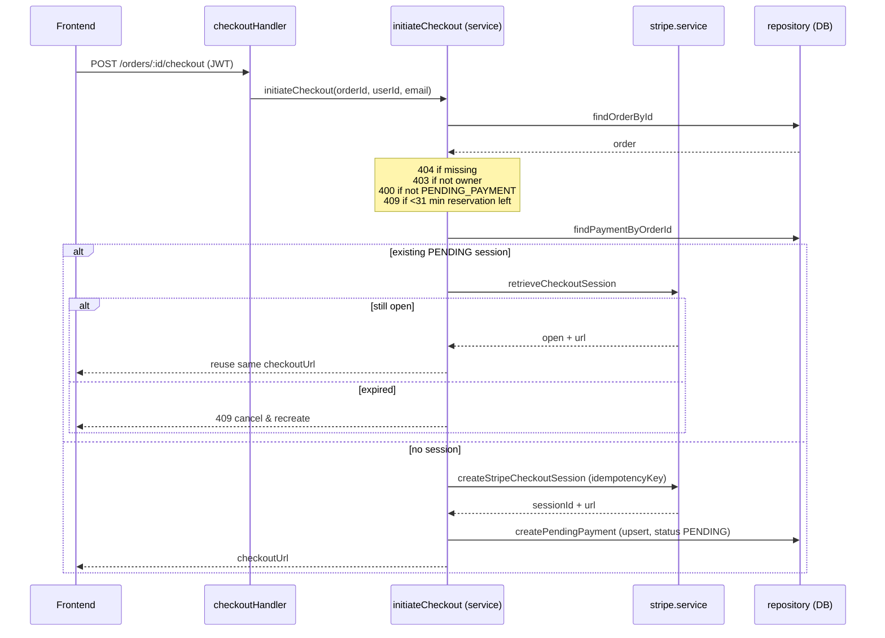
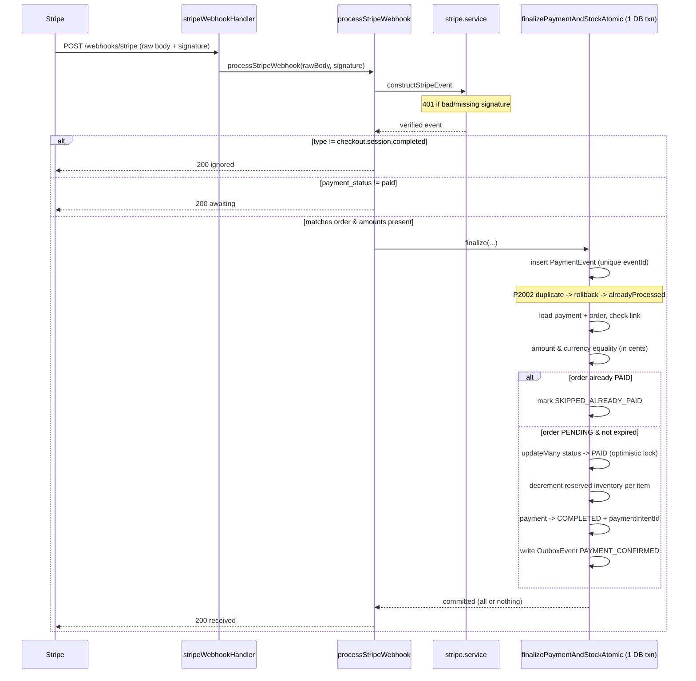
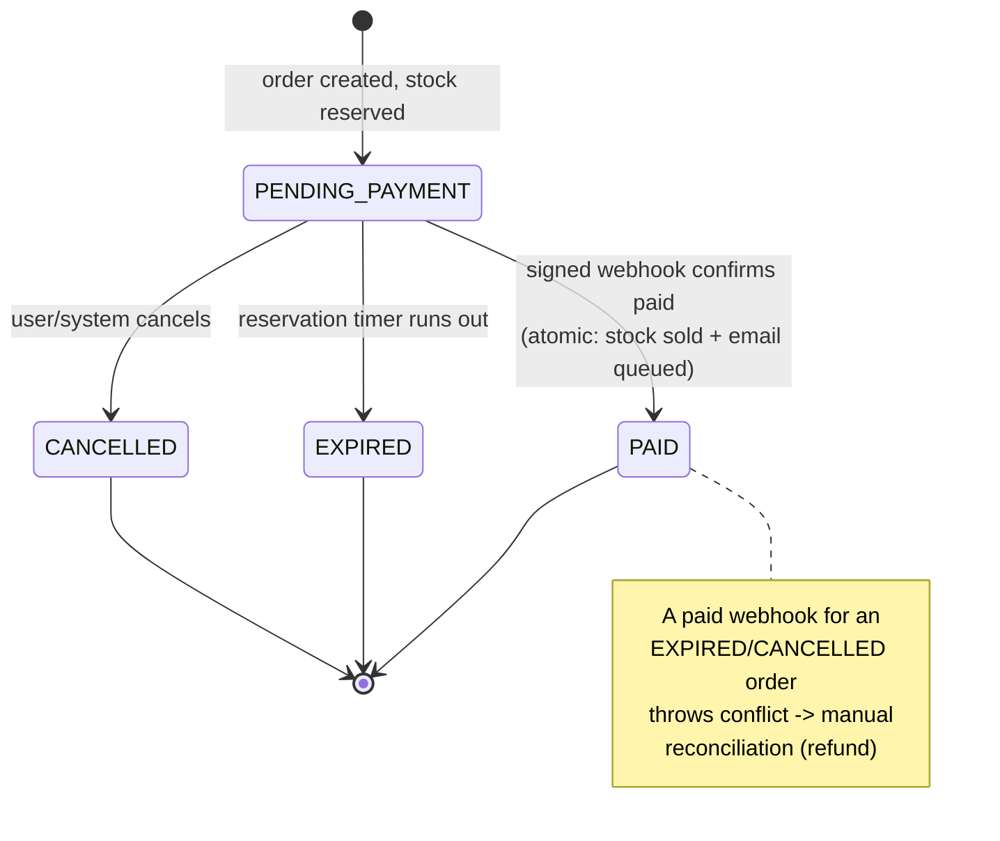

# Payments Module — Stripe Checkout Flow

This module handles paying for an order with Stripe. It uses **Stripe Checkout** (Stripe's hosted payment page), and treats the **signed webhook** as the single source of truth for when an order is actually paid.

---

## Files

| File | Job |
|------|-----|
| `payment.routes.ts` | Maps URLs to handlers |
| `payment.controller.ts` | Reads user/order from the request, calls the service, returns JSON |
| `payment.service.ts` | Business rules (the brain) |
| `stripe.service.ts` | Talks to the Stripe API, verifies webhook signatures |
| `payment.repository.ts` | Talks to the database (Prisma) |

## Endpoints

| Method & path | Auth | Purpose |
|---------------|------|---------|
| `POST /orders/:id/checkout` | JWT | Start payment, get a Stripe checkout URL |
| `GET /orders/:id/payment` | JWT | Read the current payment/order status |
| `POST /webhooks/stripe` | Public (signed) | Stripe tells us the payment happened |

> The webhook route uses a **raw body parser**, not JSON — the raw bytes are required to verify Stripe's signature.

---

## Big picture

---

## Part 1 — Starting checkout (`POST /orders/:id/checkout`)

When the customer clicks "Pay now", `initiateCheckout` runs these checks in order:

1. Find the order → `404` if missing.
2. The caller must own the order → otherwise `403`.
3. Order status must be `PENDING_PAYMENT` → otherwise `400`.
4. **Reservation time check:** stock is only reserved for a window (`expiresAt`). If less than ~31 minutes remain, refuse → `409` (not enough time to safely pay).
5. **Reuse check:** if a `PENDING` payment with a Stripe session already exists:
   - Ask Stripe if the session is still `open` → if yes, return the **same** URL (no duplicate session).
   - If it's expired/closed → `409`, cancel the order and create a new one.
6. Otherwise create a fresh Stripe Checkout Session (prices converted to cents, line items from the order).
7. Save a `Payment` row with status `PENDING`, linked to the Stripe session id.
8. Return `checkoutUrl`; the frontend redirects the customer to Stripe.

**Safety details in the code:**
- Stripe is called with an `idempotencyKey` of `checkout:<orderId>` — retrying the request won't create two sessions on Stripe's side.
- `createPendingPayment` uses an **upsert** keyed on `stripeSessionId` with `update: {}` — a duplicate call never overwrites or resets an existing payment.

---

## Part 2 — Customer pays on Stripe

The customer is on Stripe's hosted page; our server is not involved. When done, Stripe redirects the browser to `success_url` or `cancel_url` (`/checkout/return?...`).

> **Important:** that redirect is only for the user's screen. We **never** mark an order paid from the redirect — the browser could close or the network could drop. The real confirmation is the webhook (Part 3).

---

## Part 3 — The webhook (`POST /webhooks/stripe`) — the real confirmation

Stripe's servers call this public endpoint. `processStripeWebhook` does:

1. **Verify the signature** (`constructStripeEvent`) using the raw body + webhook secret → `401` if missing/invalid. Proves the request genuinely came from Stripe.
2. **Filter type** — only `checkout.session.completed` is handled; anything else is acknowledged and ignored.
3. **Check `payment_status === "paid"`** — a session can complete without being paid; if not paid, acknowledge and do nothing.
4. **Validate match** — `metadata.orderId` must equal `client_reference_id`, and `amount_total` + `currency` must be present → otherwise `400`.
5. Hand off to `finalizePaymentAndStockAtomic` (one DB transaction, all-or-nothing).

### Inside the atomic transaction (`finalizePaymentAndStockAtomic`)

Everything below runs in **one** DB transaction — all of it commits, or none of it does:

1. **Insert a `PaymentEvent`** keyed on the unique `providerEventId` (Stripe's event id). This is the **idempotency guard**: if Stripe redelivers the same event, the insert hits `P2002`, the transaction rolls back, and we return `{ alreadyProcessed: true }`. No double-processing.
2. **Load the payment** by session id; confirm it's linked to this order and provider is `STRIPE`.
3. **Load the order** with its items.
4. **Amount & currency guard:** order currency, payment currency, and Stripe's currency must all match; payment amount must equal order total; and `order.totalAmount * 100` must equal Stripe's `amount_total` (cents). Stops tampering/mismatch.
5. **Already paid?** If the order is already `PAID`, mark the event `SKIPPED_ALREADY_PAID` and stop — never sell stock twice.
6. **Still valid?** If the order isn't `PENDING_PAYMENT` or has expired, throw a conflict — a paid session for a dead order needs manual reconciliation (e.g. a refund).
7. **Flip status atomically:** `updateMany` with a `where` re-checking `status = PENDING_PAYMENT AND not expired`. If not exactly 1 row changed, someone else changed it → conflict. (Optimistic locking.)
8. **Convert reserved stock into a sale:** decrement `reservedQuantity` per item, only if enough is reserved. If count isn't exactly 1 → mismatch → rollback.
9. **Mark payment `COMPLETED`** and store `stripePaymentIntentId`.
10. **Write an `OutboxEvent`** (`PAYMENT_CONFIRMED`) in the same transaction — the **transactional outbox pattern**. The confirmation email is guaranteed to be queued exactly when the payment commits (no "paid but no email" gap). A separate worker reads the outbox and sends the email later.

---

## Part 4 — Checking status (`GET /orders/:id/payment`)

A simple read. Finds the order, checks the caller owns it **or** is an `ADMIN` (else `403`), and returns order status + payment status. The frontend can poll this after the redirect to show "Payment confirmed" once the webhook has done its work.

---

## Order state machine

---

## Why this design is solid

| Problem | Defense |
|---------|---------|
| Webhook delivered twice | Unique `providerEventId` insert → `P2002` → treated as duplicate |
| User double-clicks / retries checkout | Stripe `idempotencyKey` + DB `upsert` with no overwrite |
| Price/currency tampering | Strict amount + currency equality checks in cents |
| Browser redirect unreliable | Source of truth is the signed webhook, not `success_url` |
| Selling stock twice | `updateMany` status re-check (optimistic lock) + already-`PAID` short-circuit |
| "Paid but no email" | Transactional outbox written inside the same transaction |

---

## Environment / configuration

These are read from `config/env.ts`:

| Variable | Used for |
|----------|----------|
| `STRIPE_SECRET_KEY` | Authenticating to the Stripe API (checkout, retrieve). Missing/placeholder → `503 PAYMENTS_UNAVAILABLE` |
| `STRIPE_WEBHOOK_SECRET` | Verifying webhook signatures. Missing/placeholder → `503 PAYMENTS_UNAVAILABLE` |
| `PUBLIC_BASE_URL` | Building the `success_url` / `cancel_url` for Checkout |

---

## One-line summary

We create a Stripe-hosted checkout, trust nothing from the browser redirect, and mark the order paid **only** when Stripe's signed webhook confirms it — inside a single atomic transaction that also sells the reserved stock and queues the confirmation email, with duplicate-delivery and tampering guards at every step.
